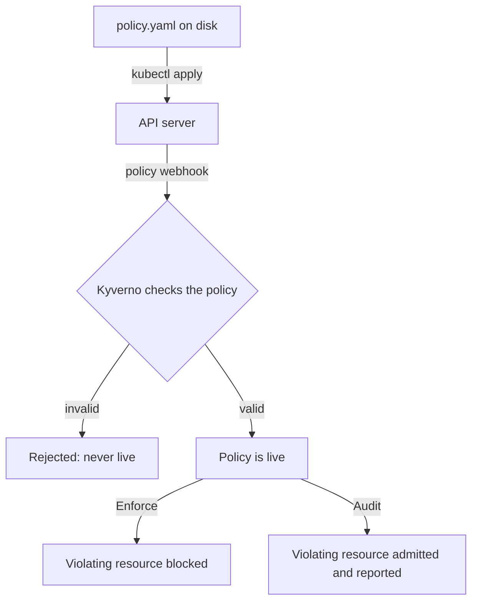

# Getting a Policy Live: ClusterPolicy vs Policy & the Admission Path

Writing a correct `ClusterPolicy` is not the same as having a policy that protects your cluster. Between the two sits a small set of operational steps: apply the object, check that Kyverno accepted it and marked it ready, and decide whether a failing resource is blocked or only logged. This module covers those steps. It is about the gap between a policy file on disk and a policy that is live.

A `ClusterPolicy` and a `Policy` are custom resources: object kinds that Kyverno adds to the Kubernetes API. Kyverno itself runs an admission controller, which is the component that receives each create and update request from the API server and checks it against the live policies.

The diagram shows two gates. The first gate checks the policy object itself. The second gate, `validationFailureAction`, decides what happens to every resource that later breaks the policy.

## How this module is organised

1. **Applying ClusterPolicy and Policy with kubectl** covers `kubectl apply`, a server-side dry run, `kubectl diff`, the rejection of a malformed policy, the scope of `Policy` against `ClusterPolicy`, and updating and deleting a policy.
2. **Enforce vs Audit at Apply Time** covers what `validationFailureAction` controls, how an Audit-first rollout works, and how `validationFailureActionOverrides` stages it per namespace.
3. **Inspecting Policy Status, Reports and Events** covers the `Ready` condition, `kubectl describe`, `PolicyReport` objects and Kubernetes events, so you can prove what a policy did.
4. **Summary** closes the module.

## Learning objectives

After this module you can:

- Apply, inspect, update and delete a `ClusterPolicy` or `Policy` with `kubectl apply`, `kubectl get`, `kubectl describe` and `kubectl delete`.
- Check a policy before it goes live with `kubectl apply --dry-run=server` and `kubectl diff`.
- Explain that Kyverno validates the policy object itself, and that a malformed policy is rejected before it becomes live.
- Choose between a `Policy` (one namespace) and a `ClusterPolicy` (the whole cluster).
- Explain `validationFailureAction: Enforce` and `Audit`, why teams ship a new policy as `Audit` first, and what `validationFailureActionOverrides` does.
- Read the `Ready` condition, a `PolicyReport` result and the related events to prove what a policy did.

## Before you start

You should be comfortable with basic `kubectl` use (`kubectl get`, `kubectl apply -f`, `kubectl describe`) and know what a `ClusterPolicy` is at a structural level. The playground gives you a kind Kubernetes cluster with Kyverno 1.13.2 installed and `kubectl` already configured. Run every command in this module in that terminal.

Launch the playground now and keep it open while you read. Each part tells you when to start typing.

<!-- astrona:playground -->
