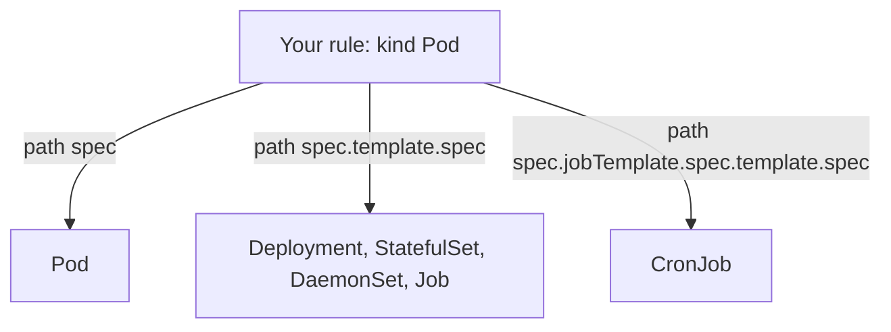

# Autogen for Pod Controllers

Nobody runs bare Pods in production. People create Deployments, StatefulSets, DaemonSets, Jobs and CronJobs, and those controllers create the Pods. This part explains how Kyverno makes a rule written for `Pod` also protect those controllers, how to read what it generated, and how to control it.

## The blind spot autogen removes

Suppose you write a rule with `match.resources.kinds: [Pod]`. A user then applies a Deployment with a non-compliant Pod template. Without more help, the API server would accept the Deployment, the ReplicaSet would try to create Pods, and Kyverno would reject each Pod. The Deployment would exist and show failing replicas, but the real fault would be reported far from where the user made it.

Autogen fixes this. When a rule matches `Pod`, Kyverno automatically creates extra rules for the controllers that own a Pod template. These rules apply the same check to the template inside the controller. Admission then rejects the Deployment itself, with a clear error, at the moment the user applies it.

<!-- astrona:playground:renew -->

Save this as `require-limits-enforce.yaml`:

```yaml
apiVersion: kyverno.io/v1
kind: ClusterPolicy
metadata:
  name: require-limits-enforce
spec:
  validationFailureAction: Enforce
  background: true
  rules:
    - name: check-limits
      match:
        any:
          - resources:
              kinds:
                - Pod
              namespaces:
                - background-ns
      validate:
        message: "Every container must set resources.limits.cpu and resources.limits.memory."
        pattern:
          spec:
            containers:
              - resources:
                  limits:
                    cpu: "?*"
                    memory: "?*"
```

Apply it and read the policy back:

```sh
kubectl apply -f require-limits-enforce.yaml
kubectl get clusterpolicy require-limits-enforce -o yaml
```

Your file has one rule. The object that comes back has more. Kyverno 1.13 keeps the generated rules in `status.autogen.rules`, and older versions put them next to your rule in `spec`. Their names start with `autogen-`. The rule for CronJob starts with `autogen-cronjob-`. You can list the names:

```sh
kubectl get clusterpolicy require-limits-enforce -o jsonpath='{.status.autogen.rules[*].name}{"\n"}'
```

## What the generated rule looks like

Autogen does not copy your rule unchanged. It moves the paths so that they point at the Pod template. Your pattern checks `spec.containers`. For a Deployment, the generated pattern checks `spec.template.spec.containers`. For a CronJob it checks `spec.jobTemplate.spec.template.spec.containers`. The `match` kinds change from `Pod` to the controller kinds.



The diagram shows that one authored rule gives three variants, each with the path of its own Pod template.

Now try to create a Deployment without limits. Save this as `deploy-new-worker.yaml`:

```yaml
apiVersion: apps/v1
kind: Deployment
metadata:
  name: new-worker
  namespace: background-ns
spec:
  replicas: 1
  selector:
    matchLabels:
      app: new-worker
  template:
    metadata:
      labels:
        app: new-worker
    spec:
      containers:
        - name: new-worker
          image: nginx:alpine
```

```sh
kubectl apply -f deploy-new-worker.yaml
```

The command fails with an error that names the policy and the autogen rule. Kyverno rejected the Deployment, not a Pod created later.

## The autogen-controllers annotation

The annotation `pod-policies.kyverno.io/autogen-controllers` on the policy controls which controllers get generated rules. Older versions of Kyverno added the annotation to your policy on their own. In version 1.13 you set it yourself when you want to change the default. The default set is Deployment, DaemonSet, StatefulSet, Job and CronJob. Some versions also include ReplicaSet and ReplicationController, so read the generated rules instead of assuming.

| Annotation value | Result |
| --- | --- |
| Not set | Autogen creates rules for the default controllers |
| `Deployment,StatefulSet` | Only those controllers get generated rules |
| `none` | Autogen is off. Your rule applies only to Pods, exactly as written |

Disable autogen when the rule only makes sense on a Pod, for example when it depends on something that a Deployment does not have. Restrict it when you only care about some controllers. Save this fragment in a policy to restrict it:

```yaml
metadata:
  name: require-limits-enforce
  annotations:
    pod-policies.kyverno.io/autogen-controllers: Deployment,StatefulSet
```

After you apply a change to the annotation, list the generated rule names again and compare.

You now know that a Pod rule reaches controllers and how to read and control it. The consequence is that an exception for a Deployment must also cover the generated rule, which is the next part.

## Common pitfalls

> [!WARNING]
> - Looking for the generated rules only in `spec`. In Kyverno 1.13 they are in `status.autogen.rules`.
> - Excluding Deployment kinds in a Pod rule to turn off autogen. The rule never matched those kinds, so this changes nothing. Use the annotation with the value `none`.
> - Assuming autogen happened for every rule. Always read the generated rules, because a rule with a more complex `match` may be handled differently.
