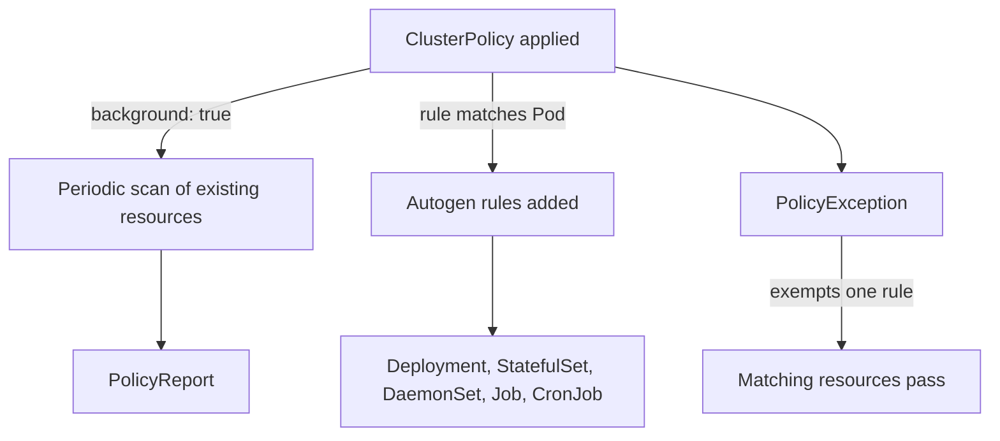

# Applying Beyond Admission: Background Scans, Autogen & Exceptions

Admission control only looks at a resource at the moment someone creates or updates it. It says nothing about the Deployment that has been running for eight months, and a rule written for `Pod` has a blind spot for the Deployment that owns the Pods. This module covers the three mechanisms Kyverno provides for those gaps: background scanning of resources that already exist, autogen rules that extend a Pod rule to the controllers that create Pods, and PolicyExceptions for a scoped, visible override when a rule is right in general but wrong for one resource.

A `PolicyReport` is the object where Kyverno records the results of those checks. A controller in Kubernetes, such as a Deployment, is an object that creates and manages Pods for you.

The diagram shows three separate branches from one policy. Background scanning reports on old resources, autogen widens the admission check, and a PolicyException narrows it again for chosen resources.

## How this module is organised

1. **Background Scanning Already-Existing Resources** covers what `background: true` re-checks, how a result changes after a fix, and which rules cannot be scanned.
2. **Autogen for Pod Controllers** covers how a Pod rule becomes rules for Deployments and other controllers, how to read them, and how to restrict or disable them with `pod-policies.kyverno.io/autogen-controllers`.
3. **PolicyExceptions in Depth** covers how to enable PolicyExceptions, every field of the object, and how to write exceptions that stay narrow.
4. **Summary** closes the module.

## Learning objectives

After this module you can:

- Explain what `background: true` does, that it only applies to `validate` rules, and where the findings are recorded.
- Turn background scanning off for a rule with `background: false` and say when to do it.
- Explain autogen, read the generated rules, and restrict or disable them with the `pod-policies.kyverno.io/autogen-controllers` annotation.
- Enable PolicyException support and write an exception that exempts specific resources from specific rules, including the autogen rule names.
- Check that an exception is active and review all exceptions in a cluster.

## Before you start

You should know how to apply a `ClusterPolicy` and read `validationFailureAction`. The playground gives you a kind Kubernetes cluster with Kyverno 1.13.2 installed and a Deployment `legacy-worker` already running without resource limits in the namespace `background-ns`. That is the situation you meet when you turn on policy in a cluster that already has workloads.

Launch the playground now and keep it open while you read.

<!-- astrona:playground -->
