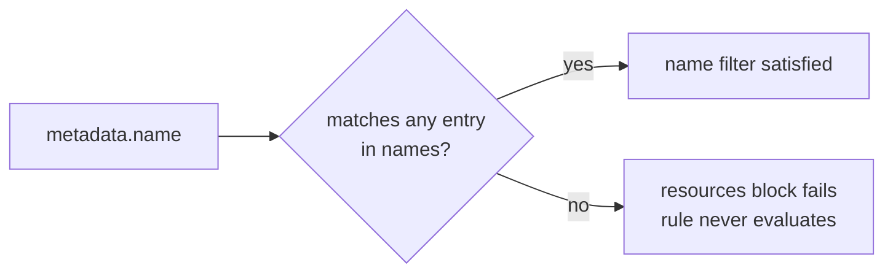

# Part 1: Selecting by Kind, Name & Wildcards

## The shape of a match block

Before the individual fields, note the outer shape. A rule's `match` contains a list under `any` (OR) or `all` (AND). Each entry in that list is a *filter*, and a filter can carry a `resources` block, plus identity fields (`subjects`, `roles`, `clusterRoles`). Everything in this module happens inside one `resources` block:

```yaml
match:
  any:                       # list of filters: at least one must match
  - resources:               # ONE filter. Every field below is ANDed.
      kinds: [ConfigMap]
      names: ["prod-*"]
      namespaces: [shop-prod]
```

The rule above selects a ConfigMap **and** named `prod-...` **and** in `shop-prod`. Inside one `resources` block, adding a field can only make the selection narrower. That single idea explains most "why did my rule not fire" mysteries.

> [!NOTE]
> Older policies write `match: resources: ...` directly, without `any`/`all`. It still works, but new policies should use `any`/`all`, because only they let you combine more than one filter.

## `resources.kinds`: what shape of object

The first thing every `match` block usually declares is *which Kind of resource* it cares about:

```yaml
match:
  any:
  - resources:
      kinds:
        - Pod
```

`kinds` is a list, so a single rule can watch several object types at once, for example `[Pod, Deployment, StatefulSet]` for a rule that applies the same check across every workload shape. The list is an OR: a Deployment satisfies the filter, and so does a Pod.

Most of the time a bare Kind name (`Pod`, `ConfigMap`, `Ingress`) is unambiguous. Kyverno accepts four spellings, from loosest to most precise:

| Spelling | Example | When to use it |
| --- | --- | --- |
| `Kind` | `Ingress` | Almost always. Kyverno resolves it against the cluster's API discovery. |
| `version/Kind` | `v1/Pod` | Core-group resources, when you want to pin the version. |
| `group/version/Kind` | `networking.k8s.io/v1/Ingress`, `apps/v1/Deployment` | Two API groups define the same Kind name (common with CRDs), or you want to pin an API version. |
| `Kind/subresource` | `Pod/exec`, `Pod/status`, `Deployment/scale` | The rule must see a subresource request rather than the main object. |

```yaml
kinds:
  - apps/v1/Deployment
  - networking.k8s.io/v1/Ingress
  - Pod/exec
```

> [!TIP]
> **Try it: see the fully-qualified kind**
>
> ```sh
> kubectl api-resources -o wide | grep -i deployment
> ```
> The `APIVERSION` column (`apps/v1`) combined with the `KIND` column is exactly the `group/version/Kind` string you use when you need to disambiguate.

### Subresources are separate requests

A subresource is an extra endpoint hanging off an object, such as `pods/exec`, `pods/status`, `pods/eviction` or `deployments/scale`. When someone runs `kubectl exec`, the API server does not send an update to the Pod. It sends a `CONNECT` request to the `pods/exec` subresource. A rule that lists only `kinds: [Pod]` never sees that request, because the request is for `Pod/exec`:

```yaml
match:
  any:
  - resources:
      kinds:
        - Pod/exec
      operations:
        - CONNECT
```

A rule like this is the standard way to block or audit shell access into Pods (the `validate` part would use a `deny` rule). You can write `Pod/*` to mean the Pod and all its subresources, but be deliberate. Wide patterns make a rule run on far more admission requests than you intended.

> [!NOTE]
> A bare `Pod` entry matches the Pod object itself, not its subresources. If a rule on `Pod` is "not firing" for `exec`, `status` or `scale` traffic, the missing piece is almost always the `/subresource` suffix.

## `name` vs `names`

Once `kinds` narrows the *type*, `name`/`names` can narrow the *specific object(s)*:

| Field | Shape | Use case |
| --- | --- | --- |
| `name` | Single string, wildcard-capable | One specific object, or one wildcard pattern |
| `names` | List of strings, each wildcard-capable | Several specific objects or patterns in one rule |

```yaml
resources:
  kinds:
    - ConfigMap
  names:
    - "prod-*"
    - "canary-*"
```

This matches any `ConfigMap` whose name starts with `prod-` **or** starts with `canary-`. The list is evaluated as OR. Use `names` whenever you have more than one pattern; it is easier to read than several near-identical filters.

> [!NOTE]
> `name`/`names` compare against `metadata.name`. Objects created with `generateName` (the Pods a Deployment creates, for instance) have no final name at the moment some admission requests are built. If a name-scoped rule misses controller-created objects, the safer scope is a label (`selector`) or the namespace.

## The wildcards: `*` and `?`

Kyverno uses simple glob matching in `name`, `names`, `namespaces`, and annotation values:

| Wildcard | Means | Example | Matches | Does not match |
| --- | --- | --- | --- | --- |
| `*` | Zero or more characters | `prod-*` | `prod-api`, `prod-` | `staging-prod-api` |
| `?` | Exactly one character | `app-?` | `app-1`, `app-a` | `app-`, `app-10` |
| both | Combine as needed | `*-secrets` | `db-secrets`, `app-secrets` | `secrets-db`, `app-secrets-v2` |

It is a glob, not a regular expression: there are no character classes, no alternation and no anchors. The rest of the string must match literally, and the match covers the **whole** name. That is why `*-secrets` does not match `app-secrets-v2`: the name does not end in `-secrets`.

Try each candidate against `names: ["db-?", "cache-*"]`:

| Name | Result | Why |
| --- | --- | --- |
| `db-1` | match | `?` takes the `1` |
| `db-12` | no match | `?` is exactly one character |
| `cache-` | match | `*` may match zero characters |
| `my-cache-a` | no match | The name must start with `cache-` |



> [!WARNING]
> **A wildcard on `name` is not a security boundary**
>
> Consider a rule scoped to `names: ["*-secrets"]` intending to catch every `ConfigMap` holding sensitive data. This looks precise, but `name` matching only ever inspects the string in `metadata.name`. It says nothing about the object's actual *content*. A `ConfigMap` named `app-secrets` that stores nothing sensitive is caught by the rule; a `ConfigMap` named `credentials` (no `-secrets` suffix) that stores an actual password sails straight through unmatched. Naming conventions are a hint for humans, not a security control Kyverno enforces on your behalf. If the goal is genuinely "catch anything holding sensitive data," you need a rule based on the object's actual keys, labels or annotations, not its name string.
>
> A name pattern is also trivially bypassed: anyone who creates the object under a different name skips the rule, whether that is an oversight or deliberate.

> [!TIP]
> **Try it: match by a wildcard name in the playground**
>
> `shop-prod` already holds ConfigMaps named `app-secrets`, `db-secrets`, `credentials` and `prod-settings`. Apply an Enforce policy that requires a `classified` label on ConfigMaps whose name ends in `-secrets` in `shop-prod`:
> ```sh
> cat <<'EOF' | kubectl apply -f -
> apiVersion: kyverno.io/v1
> kind: ClusterPolicy
> metadata:
>   name: try-secrets-labelled
> spec:
>   validationFailureAction: Enforce
>   background: false
>   rules:
>     - name: need-classified-label
>       match:
>         any:
>         - resources:
>             kinds: [ConfigMap]
>             names: ["*-secrets"]
>             namespaces: [shop-prod]
>       validate:
>         message: "Secret-named ConfigMaps need the label classified."
>         pattern:
>           metadata:
>             labels:
>               classified: "?*"
> EOF
> ```
> Now use server-side dry-run to ask the API server (and so Kyverno) about four new ConfigMaps without creating anything. Predict each one first:
> ```sh
> for n in cache-secrets secrets-cache credentials app-secrets-v2; do
>   echo "--- $n"
>   kubectl create configmap "$n" -n shop-prod --from-literal=k=v --dry-run=server -o name
> done
> ```
> `cache-secrets` is rejected (name matches, label missing). The other three are admitted: `secrets-cache` and `app-secrets-v2` do not end in `-secrets`, and `credentials` has no `-secrets` suffix at all, which is exactly the "naming is not security" gap from the warning. Delete the policy when done: `kubectl delete cpol try-secrets-labelled`.

## Putting kind and name together: worked prediction

Read this rule, then answer before you scroll on:

```yaml
match:
  any:
  - resources:
      kinds: [Deployment, StatefulSet]
      names: ["web-*"]
```

| Request | Selected? | Reason |
| --- | --- | --- |
| Deployment `web-api` | yes | Kind in list, name matches |
| StatefulSet `web-db` | yes | `kinds` is an OR, `web-*` matches |
| DaemonSet `web-agent` | no | Kind not listed |
| Deployment `api-web` | no | Name does not start with `web-` |

## Reference

- `kubectl explain clusterpolicy.spec.rules.match.any.resources`: the live schema for `kinds`/`name`/`names` on your installed Kyverno CRD version.
- `kubectl api-resources`: the authoritative list of Kind names and their API groups/versions available on your cluster.
- `kubectl get --raw /api/v1 | grep -o '"name":"pods/[a-z]*"'`: lists the Pod subresources your API server serves.
