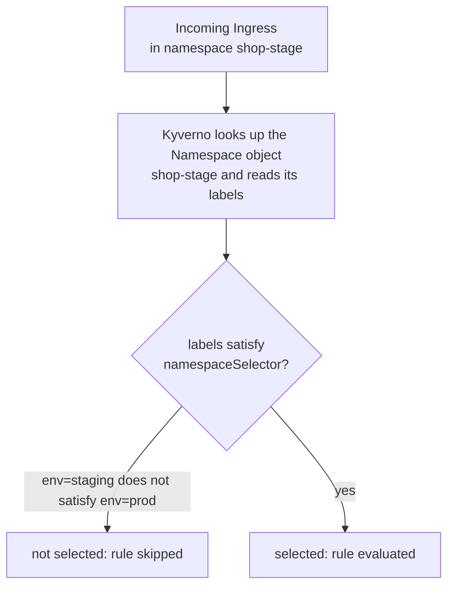
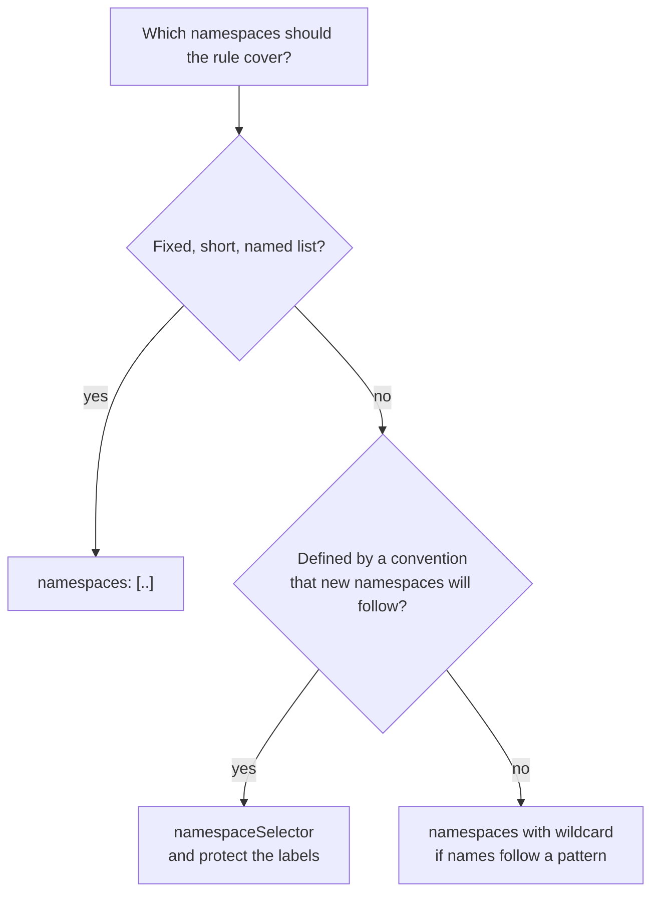

# Part 2: Namespaces & namespaceSelector

## `resources.namespaces`: a static list

The most direct way to scope a `ClusterPolicy` rule to particular namespaces is a literal list:

```yaml
match:
  any:
  - resources:
      kinds:
        - Ingress
      namespaces:
        - shop-prod
```

Like `names`, entries here are wildcard-capable (`"shop-*"` would match `shop-prod`, `shop-dev` and `shop-stage` alike). But the list itself is **static**: it names namespaces by their literal identifiers, written directly into the policy YAML. Add a new namespace tomorrow that should also be in scope, and the policy does nothing about it until someone edits the list (or the wildcard happens to cover it).

> [!NOTE]
> A namespace filter only means something for namespaced resources. A Pod, an Ingress or a ConfigMap lives in a namespace, so `namespaces` can select it. A cluster-scoped kind such as `ClusterRole` or `Node` has no namespace to compare. Do not expect `namespaces` or `namespaceSelector` to narrow a cluster-scoped kind the way it narrows a namespaced one.

## `namespaceSelector`: a dynamic, label-driven scope

`namespaceSelector` takes a different approach: instead of naming namespaces, it names a **label selector**, evaluated against the *Namespace object itself*. That means the labels on the `Namespace` resource the matched object lives inside, not the labels on the matched object.

```yaml
match:
  any:
  - resources:
      kinds:
        - Ingress
      namespaceSelector:
        matchLabels:
          env: prod
```

This rule applies to an `Ingress` in *any* namespace, as long as that namespace currently carries the label `env: prod`. `namespaceSelector` supports the full Kubernetes label selector grammar: `matchLabels` for exact key/value equality, and `matchExpressions` for the operators `In`, `NotIn`, `Exists` and `DoesNotExist`.

```yaml
namespaceSelector:
  matchExpressions:
    - key: env
      operator: In
      values: [prod, staging]
    - key: team
      operator: Exists
```

A selector's entries (`matchLabels` and every `matchExpressions` item) are ANDed: this selects namespaces whose `env` is `prod` or `staging` **and** that have some `team` label.



## Static vs dynamic: why it matters

| | `resources.namespaces` | `namespaceSelector` |
| --- | --- | --- |
| What it reads | A literal list in the policy YAML | Labels on the live `Namespace` object |
| Scope changes when... | You edit the policy | A namespace's labels change, no policy edit needed |
| Typical use | A small, fixed, deliberately-enumerated set | An organization-wide convention ("every namespace labeled `env: prod`") that new namespaces should automatically join |
| Failure mode | A new namespace is silently left out | A namespace is silently pulled in (or out) by a label edit |

The dynamic behavior of `namespaceSelector` cuts both ways. It's exactly what you want for "every production namespace, forever, including ones that don't exist yet": no one has to remember to update the policy when a new team spins up a new prod namespace and labels it correctly. But it also means a namespace's scope under a policy can change from something that happened nowhere near the policy itself: someone runs `kubectl label namespace shop-dev env=prod` for an unrelated reason, and every `namespaceSelector: {env: prod}` policy in the cluster now applies to it too.

> [!WARNING]
> **A `namespaceSelector` policy is only as good as the labels underneath it**
>
> `namespaceSelector: {matchLabels: {env: prod}}` matches nothing at all in a namespace that was never labeled `env: prod` in the first place. The rule simply never sees it, with no error, no warning, no indication anything is missing. If a policy that should be protecting production appears to be doing nothing, checking `kubectl get namespace --show-labels` for the expected label is one of the first things to verify.
>
> Remember who can write those labels: anyone with `update` on namespaces. A team that can relabel its own namespace from `env=prod` to `env=sandbox` just stepped out of every prod guardrail. Protect the label itself (RBAC, or a policy on Namespace updates) when the scope matters.

## Combining `namespaces` and `namespaceSelector`

Both fields can sit in the same `resources` block, and, as with every field in one block, they are ANDed. The namespace must be in the list **and** carry the label:

```yaml
resources:
  kinds: [Ingress]
  namespaces: ["shop-*"]
  namespaceSelector:
    matchLabels:
      env: prod
```

Of the three playground namespaces, only `shop-prod` passes both. `shop-dev` fails the label, and a namespace called `billing-prod` fails the name list even though its label is right. The AND is a useful safety belt (a typo in a label cannot widen the scope beyond `shop-*`) and a common source of confusion (a correct label in a differently-named namespace is not selected).

Need "either one"? Use two filters under `any`:

```yaml
match:
  any:
  - resources:
      kinds: [Ingress]
      namespaces: [legacy-prod]
  - resources:
      kinds: [Ingress]
      namespaceSelector:
        matchLabels:
          env: prod
```

## Choosing between them



> [!TIP]
> **Try it: watch a namespaceSelector scope change live**
>
> In the playground, first apply a small Enforce policy scoped by label (it requires an `owner` annotation on ConfigMaps):
> ```sh
> cat <<'EOF' | kubectl apply -f -
> apiVersion: kyverno.io/v1
> kind: ClusterPolicy
> metadata:
>   name: try-prod-owner
> spec:
>   validationFailureAction: Enforce
>   background: false
>   rules:
>     - name: need-owner
>       match:
>         any:
>         - resources:
>             kinds: [ConfigMap]
>             namespaceSelector:
>               matchLabels:
>                 env: prod
>       validate:
>         message: "ConfigMaps in prod namespaces need an owner annotation."
>         pattern:
>           metadata:
>             annotations:
>               owner: "?*"
> EOF
> ```
> Ask the API server about the same ConfigMap in two namespaces, using dry-run so nothing is created:
> ```sh
> kubectl create configmap probe -n shop-prod --dry-run=server -o name
> kubectl create configmap probe -n shop-stage --dry-run=server -o name
> ```
> The `shop-prod` request is rejected and the `shop-stage` one is admitted. Now change only a label, not the policy:
> ```sh
> kubectl label namespace shop-stage env=prod --overwrite
> kubectl create configmap probe -n shop-stage --dry-run=server -o name
> ```
> The same request is now rejected. Restore it with `kubectl label namespace shop-stage env=staging --overwrite`, and remove the policy with `kubectl delete cpol try-prod-owner`.

## What `namespaceSelector` does not do

- It never reads the labels of the **resource** you are validating. That is the job of the `selector` field . A Pod labeled `env: prod` in a namespace without that label is not selected by `namespaceSelector: {env: prod}`.
- It is not evaluated once at apply time. Each admission request resolves the namespace's labels again.
- It does not retroactively change objects that already exist. A namespace that joins the scope later is evaluated for new admission requests (and for background scans on policies that allow them), not rewritten.

## Reference

- `kubectl explain clusterpolicy.spec.rules.match.any.resources.namespaceSelector`: the live schema, identical in shape to a Pod's `spec.affinity.*.namespaceSelector`.
- `kubectl get namespace --show-labels`: the first command to run when a label-scoped policy "does nothing".
- `kubectl label namespace <name> <key>=<value>`: the command that puts a namespace in or out of scope of every `namespaceSelector`-based policy in the cluster at once.
