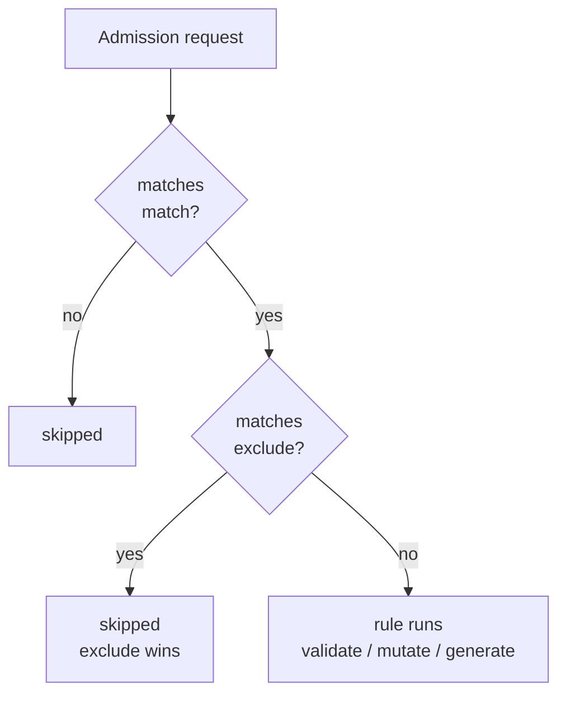
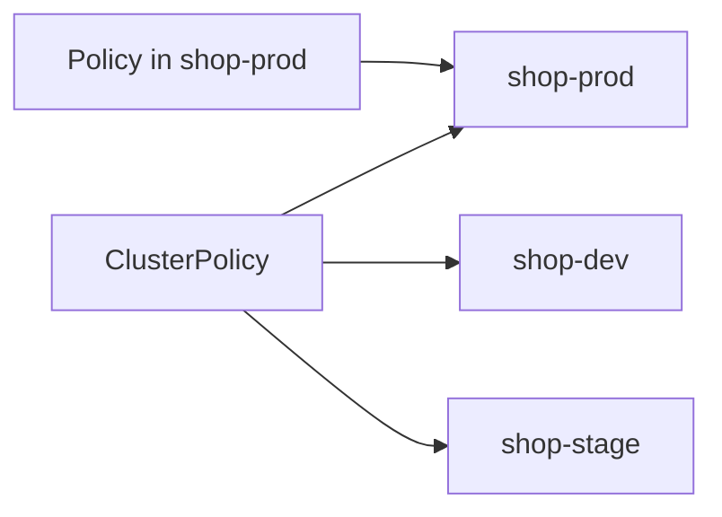

# Part 3: Annotations, Exclude Precedence & Policy Scope Patterns

Parts 1 and 2 gave you the building blocks: kind, name, namespace. This part adds one more matching field (`annotations`), then answers the question every real policy author hits within a week: *what happens when `match` and `exclude` both have an opinion?* It closes with the difference between a namespaced `Policy` and a `ClusterPolicy`, and three reusable scoping patterns.

## `annotations`: match on a metadata flag

`resources.annotations` selects objects by annotations on the resource itself. Values may use the same `*` and `?` wildcards as names:

```yaml
match:
  any:
  - resources:
      kinds: [Ingress]
      annotations:
        kubernetes.io/ingress.class: "nginx"
        exposure: "public*"
```

This selects Ingresses that carry the `ingress.class` annotation set to `nginx` **and** an `exposure` annotation starting with `public`. Each listed key/value pair must match, which is the same "narrower with each field" rule as everywhere else in one `resources` block.

Annotations are good for *opt-in or opt-out flags that humans or tools write on purpose*, like `policy.example.com/skip: "true"`. Remember who writes them, though. The resource's author controls its annotations, so an annotation-based **exclude** is a self-service bypass: anyone who can create the object can add the flag. Use it only where that is acceptable, and pair it with an identity or namespace condition when it is not.

| Field | Reads | Who controls it | Good for |
| --- | --- | --- | --- |
| `names` | `metadata.name` | The object author | Naming conventions (hint, not security) |
| `namespaces` | Namespace name | Whoever creates namespaces | Fixed environments |
| `namespaceSelector` | Namespace labels | Whoever can relabel namespaces | Environment tiers |
| `annotations` | Resource annotations | The object author | Opt-in/opt-out flags |
| `selector` | Resource labels | The object author | App tiers, ownership |

## How `exclude` works

`exclude` has exactly the same shape as `match` (`any` or `all`, each entry a filter), but it removes resources instead of selecting them. Kyverno first asks whether the request matches; then, if it does, whether it also matches the exclude. A resource reaches the rule logic only if it **matches `match` and does not match `exclude`**.



So **exclude always wins**. There is no way to write a `match` entry that "un-excludes" something. If a resource is in both, it is out.

```yaml
match:
  any:
  - resources:
      kinds: [Ingress]
      namespaceSelector:
        matchLabels:
          env: prod
exclude:
  any:
  - resources:
      namespaces: [shop-legacy]
```

An `Ingress` in a prod-labeled namespace is selected. If that namespace is `shop-legacy`, it is excluded. Notice the exclude names no `kinds`; that is allowed, and means "any kind" within the exclude's other fields.

### The AND trap inside one exclude block

This is the most common exclude mistake. Inside one `resources` block, fields are ANDed, in `exclude` as in `match`:

```yaml
exclude:
  any:
  - resources:
      kinds: [Ingress]
      namespaces: [shop-legacy]
      names: ["public-*"]
```

That excludes Ingresses that are in `shop-legacy` **and** named `public-*`. An Ingress named `internal-api` in `shop-legacy` is **not** excluded; neither is `public-api` in another namespace. If you meant "everything in `shop-legacy`, plus anything named `public-*` anywhere", split into two filters under `any`:

```yaml
exclude:
  any:
  - resources:
      namespaces: [shop-legacy]
  - resources:
      names: ["public-*"]
```

A short rule to remember: **fields inside one block narrow; entries in `any` widen; entries in `all` narrow again.**

> [!TIP]
> **Try it: prove exclude wins**
>
> In the playground, require a `reviewed` annotation on Ingresses in prod namespaces, but exclude names starting with `internal-`:
> ```sh
> cat <<'EOF' | kubectl apply -f -
> apiVersion: kyverno.io/v1
> kind: ClusterPolicy
> metadata:
>   name: try-exclude-wins
> spec:
>   validationFailureAction: Enforce
>   background: false
>   rules:
>     - name: need-reviewed
>       match:
>         any:
>         - resources:
>             kinds: [Ingress]
>             namespaceSelector:
>               matchLabels:
>                 env: prod
>       exclude:
>         any:
>         - resources:
>             names: ["internal-*"]
>       validate:
>         message: "Ingresses in prod need a reviewed annotation."
>         pattern:
>           metadata:
>             annotations:
>               reviewed: "?*"
> EOF
> ```
> Probe two Ingresses in `shop-prod` with a small helper (nothing is created):
> ```sh
> probe_ingress() {
>   cat <<EOF | kubectl create --dry-run=server -f - -o name
> apiVersion: networking.k8s.io/v1
> kind: Ingress
> metadata: {name: $1, namespace: $2}
> spec:
>   defaultBackend: {service: {name: svc, port: {number: 80}}}
> EOF
> }
> probe_ingress public-x shop-prod
> probe_ingress internal-x shop-prod
> ```
> `public-x` is rejected; `internal-x` is admitted because it matched `match` and then matched `exclude`. Remove the policy with `kubectl delete cpol try-exclude-wins`.

## `Policy` vs `ClusterPolicy`

The `match`/`exclude` grammar is identical in both kinds. What differs is the **outer boundary** that is applied before any of your fields:

| | `ClusterPolicy` | `Policy` |
| --- | --- | --- |
| Lives in | The cluster (no namespace) | One namespace |
| Can select | Resources in any namespace, and cluster-scoped kinds | Only resources in **its own namespace** |
| `namespaces` / `namespaceSelector` | Meaningful | Redundant: the namespace is already fixed, so do not rely on them |
| Who usually owns it | The platform or security team | A team inside its own namespace |



Practical consequences:

- A `Policy` in `shop-prod` can never affect `shop-dev`, however its `match` is written. That makes it a safe thing to delegate to a team with RBAC on `policies` in just their namespace.
- A `Policy` cannot select cluster-scoped resources such as `Namespace` or `ClusterRole`, because those do not live in any namespace.
- When a policy "works in one namespace and not another", first check whether it is a namespaced `Policy` that was applied to only one of them (`kubectl get policy -A`).

## Three scoping patterns

1. **Allow-list by convention.** `namespaceSelector: {env: prod}` + `names: ["public-*"]`: the shape of the lab for this module. Two independent axes keep the blast radius small.
2. **Broad rule with named exceptions.** Match every Pod, `exclude` the namespaces that must stay out of reach (for example `kube-system`). Prefer excluding a small, stable set over trying to enumerate everything you want to include.
3. **Opt-out with a guard.** Exclude on an annotation, but only in a namespace tier that may use it, by ANDing both inside the exclude block (`annotations` and `namespaceSelector` in one `resources` entry).

> [!WARNING]
> **Policy scope is a security decision**
>
> Every wildcard, every selector and every exclude widens or narrows who is protected. Re-read the final `match` and `exclude` together as one sentence in plain English ("Ingresses named `public-*` in env=prod namespaces, unless named `internal-*`"). If the sentence surprises you, the YAML will surprise you in production.

## Reference

- `kubectl explain clusterpolicy.spec.rules.exclude`: the schema is the same as `match`.
- `kubectl get cpol,pol -A`: lists both policy kinds so you can see which one is actually scoping a namespace.
