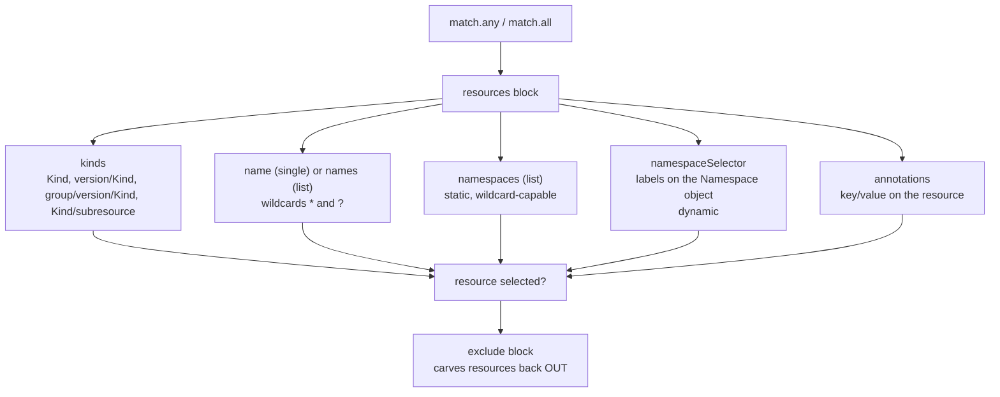

# match/exclude Fundamentals: Kinds, Names & Namespaces

Every Kyverno rule opens with the same question: *which resources does this rule even get to look at?* That question is answered entirely by the rule's `match` block (and narrowed further by an optional `exclude` block). Get this wrong and the rest of the rule, however correct its `validate`, `mutate`, or `generate` logic is, either fires on the wrong resources or never fires at all.

The `match` block of a rule decides which admission requests the rule evaluates. Kyverno's admission webhook receives every request that the API server sends for the configured kinds. For each request, the fields in `match` (kind, name, namespace, labels and others) select the rules that apply. The `exclude` block then removes requests from that selection, even though `match` selected them.

This module works through the first layer of that selection: matching by resource `kind`, by resource `name`, by the `namespace` the resource lives in (both the static list and the dynamic, label-driven `namespaceSelector`), and then the first look at `exclude`, annotations, and how `Policy` differs from `ClusterPolicy`.

## How this module is organised

1. **[Part 1: Selecting by Kind, Name & Wildcards](./course-01-selecting-by-kind-name-and-wildcards.md)**: `resources.kinds` (including `group/version/Kind` and subresources such as `Pod/exec`), `name` vs `names`, and exactly what `*` and `?` match.
2. **[Part 2: Namespaces & namespaceSelector](./course-02-namespaces-and-namespaceselector.md)**: the static `namespaces` list versus the dynamic, label-driven `namespaceSelector`, and how the two combine.
3. **[Part 3: Annotations, Exclude Precedence & Policy Scope Patterns](./course-03-annotations-exclude-precedence-and-policy-scope.md)**: matching on annotations, how `exclude` wins over `match`, and what changes between a namespaced `Policy` and a `ClusterPolicy`.
4. **[Summary](./course-04-summary.md)**: the key facts in one page.

## Learning objectives

After this module you can:

- Write a `match.resources.kinds` list, including a qualified `group/version/Kind` entry and a subresource entry such as `Pod/exec`.
- Choose between `name` and `names`, and predict exactly what `*` and `?` wildcards will and won't match.
- Scope a rule to a static list of namespaces with `resources.namespaces`.
- Scope a rule dynamically to any namespace carrying a given label with `namespaceSelector`, and explain why that scope can change without editing the policy.
- Explain that fields inside one `resources` block are ANDed, and predict the outcome when `exclude` and `match` both apply.
- Explain what a namespaced `Policy` can and cannot select compared with a `ClusterPolicy`.

## Before you start

This module assumes you're already comfortable with the basic shape of a `ClusterPolicy`/`Policy` (`spec.rules`, one action per rule). Your playground is a single-node `kind` cluster with Kyverno v1.13.2 installed and ready. It has three namespaces: `shop-prod` (label `env: prod`), `shop-dev` (label `env: dev`) and `shop-stage` (label `env: staging`), plus a few ConfigMaps with deliberately misleading names. No policy exists yet, so every Try it block in the parts is safe to run.

Launch your playground now, and keep it running next to you while you read the parts:

<!-- astrona:playground -->
