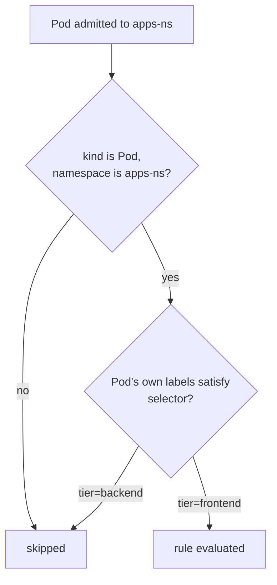
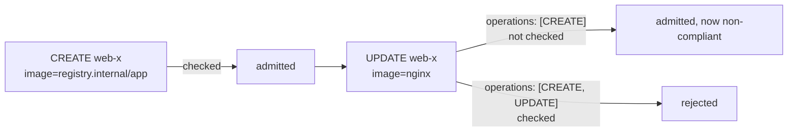

# Part 1: selector & Operations

## `selector`: labels on the resource itself

`namespaceSelector` reads labels off the *Namespace object* a resource lives in. `selector` looks somewhere different: the labels on the *matched resource itself*.

```yaml
match:
  any:
  - resources:
      kinds:
        - Pod
      namespaces:
        - apps-ns
      selector:
        matchLabels:
          tier: frontend
```

This rule only considers Pods in `apps-ns` that are themselves labeled `tier: frontend`. A Pod labeled `tier: backend` in the exact same namespace is invisible to this rule.

> [!NOTE]
> **Field name**: in a Kyverno policy the field is called `selector`. You may also have seen `objectSelector`; that name belongs to Kubernetes *webhook configurations*, not to Kyverno's `match` block. If you write `objectSelector` under `resources`, the API server refuses the policy as containing an unknown field.

> [!TIP]
> **`namespaceSelector` vs `selector`: which labels, on which object**
>
> These two fields are easy to swap by accident because they look almost identical in YAML. The distinction that matters:
> - `namespaceSelector` reads labels on the **Namespace** the resource lives in.
> - `selector` reads labels on the **resource being matched**, directly.
>
> A Pod's own labels changing on an `UPDATE` is what `selector` reacts to. A Pod does not move in or out of a `namespaceSelector` scope until its namespace's labels change.

### Equality and set-based selectors

`selector` is a standard Kubernetes label selector, so it supports both forms:

```yaml
selector:
  matchLabels:
    tier: frontend            # equality
  matchExpressions:
    - key: app
      operator: In            # In, NotIn, Exists, DoesNotExist
      values: [shop, billing]
    - key: debug
      operator: DoesNotExist
```

Everything listed is ANDed: the Pod must have `tier=frontend`, **and** `app` in `{shop, billing}`, **and** no `debug` label at all. Kyverno also allows wildcards in label keys and values in `matchLabels` (for example a value of `team-*`), which plain Kubernetes selectors do not. Test any wildcard selector with a dry-run before you trust it.

| Goal | `selector` |
| --- | --- |
| Frontend Pods only | `matchLabels: {tier: frontend}` |
| Everything except canaries | `matchExpressions: [{key: canary, operator: DoesNotExist}]` |
| Either of two apps | `matchExpressions: [{key: app, operator: In, values: [a, b]}]` |



> [!WARNING]
> **The author controls the labels**
>
> A `selector` scopes a rule by labels the **resource's author wrote**. If a policy applies only to `tier: frontend` Pods, an author who simply omits (or changes) the label walks around it. Use `selector` to *target* a rule at a class of objects, and enforce the label's presence with a separate rule when the label is itself a requirement ("every Pod must carry a `tier` label").

> [!TIP]
> **Try it: scope a rule with selector**
>
> Apply a registry rule limited to frontend Pods:
> ```sh
> cat <<'EOF' | kubectl apply -f -
> apiVersion: kyverno.io/v1
> kind: ClusterPolicy
> metadata:
>   name: try-frontend-registry
> spec:
>   validationFailureAction: Enforce
>   background: false
>   rules:
>     - name: internal-registry-only
>       match:
>         any:
>         - resources:
>             kinds: [Pod]
>             namespaces: [apps-ns]
>             selector:
>               matchLabels:
>                 tier: frontend
>       validate:
>         message: "Frontend Pods must use registry.internal/*."
>         pattern:
>           spec:
>             containers:
>               - image: "registry.internal/*"
> EOF
> kubectl run frontend-probe --image=nginx -n apps-ns --labels=tier=frontend --dry-run=server
> kubectl run backend-probe  --image=nginx -n apps-ns --labels=tier=backend  --dry-run=server
> ```
> The first request is rejected, naming the policy. The second is admitted: same namespace, same Kind, same image, different outcome purely because of the object's own labels. Leave the policy in place for the next Try it.

## `operations`: which admission verb

Every admission request Kyverno evaluates carries an operation: `CREATE`, `UPDATE`, `DELETE`, or `CONNECT` (the last one covers subresource connections like `pods/exec`). Setting `operations` inside `resources` narrows the rule to those verbs:

```yaml
match:
  any:
  - resources:
      kinds:
        - Pod
      operations:
        - CREATE
```

| Operation | Happens when | Notes |
| --- | --- | --- |
| `CREATE` | A new object is submitted | The object is `request.object`. |
| `UPDATE` | An existing object is changed (including label and annotation edits, `kubectl apply` on an existing object, controller status writes) | Both `request.object` and `request.oldObject` exist. |
| `DELETE` | An object is deleted | There is no new object. Use `request.oldObject` in conditions. |
| `CONNECT` | A subresource connection is opened (`kubectl exec`, `attach`, `port-forward`) | Pair with `Pod/exec`-style kinds. |

If you leave `operations` out, Kyverno applies a default that depends on the rule type. For `validate` and `mutate` rules that default covers object writes (`CREATE` and `UPDATE`) rather than `DELETE` or `CONNECT`, so a rule on `Pod/exec` almost always needs `operations: [CONNECT]` stated explicitly. Check the behaviour of your Kyverno version in its docs rather than assuming.

Restricting to `[CREATE]` means the rule only ever evaluates brand-new Pods. An `UPDATE` to an already-admitted Pod (for instance, a label patch) never re-triggers it. This matters in three common cases:

- **Avoiding needless re-evaluation.** A rule that only makes sense at creation time shouldn't also fire on every subsequent `UPDATE`.
- **Deliberately letting some operations bypass a rule.** A rule restricted to `[CREATE, UPDATE]` never blocks a `DELETE`. That is useful when a guardrail should stop bad objects from being written without getting in the way of cleanup.
- **Closing a gap by accident.** `[CREATE]` alone leaves a hole: someone creates a compliant Pod, then edits it into a non-compliant one. If the guardrail must hold for the whole lifetime of the object, include `UPDATE`.



> [!WARNING]
> **Common pitfall**
>
> Leaving `operations` unset is usually fine and is what most example policies do. But if a rule behaves correctly on `kubectl apply -f` (a `CREATE`) yet appears to do nothing on a subsequent edit, or vice versa, checking whether `operations` was set (and to what) is one of the first things to look at.

> [!TIP]
> **Try it: an UPDATE slips past a CREATE-only rule**
>
> With `try-frontend-registry` from above still applied (it has no `operations`), relabel the existing backend Pod into the frontend scope using a dry-run:
> ```sh
> kubectl label pod web-backend tier=frontend --overwrite -n apps-ns --dry-run=server
> ```
> The existing Pod uses a podinfo image that is not under `registry.internal/`, so the `UPDATE` is evaluated and rejected. Now delete the policy and recreate it with `operations: [CREATE]` added under `resources`, then repeat the command. The same label change is now admitted, because `UPDATE` is out of scope. Delete the policy afterwards with `kubectl delete cpol try-frontend-registry`.

## Reference

- `kubectl explain clusterpolicy.spec.rules.match.any.resources.selector`: same label-selector schema as `namespaceSelector`, evaluated against a different object.
- `kubectl explain clusterpolicy.spec.rules.match.any.resources.operations`: the live list of allowed values.
- Kubernetes API concepts documentation on admission review "operation" values, for the authoritative list beyond `CREATE`/`UPDATE`/`DELETE`/`CONNECT`.
