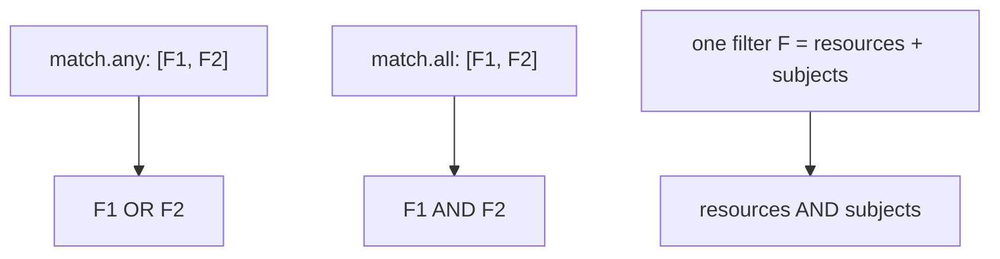

# Part 2: subjects, roles, clusterRoles & any/all

## Anatomy of a filter

Before OR and AND, be precise about what an entry in `any`/`all` *is*. Each entry is one **filter**, and a filter can hold these fields side by side:

```yaml
- resources:            # what the object is (Module 1 + selector + operations)
    kinds: [Pod]
  subjects: [...]       # who is asking (User / Group / ServiceAccount)
  roles: [...]          # who is asking, by namespaced Role
  clusterRoles: [...]   # who is asking, by ClusterRole
```

**Inside one filter, every field present is ANDed.** A filter with `resources` and `subjects` matches a request only if the object fits *and* the requester fits. That makes a filter the unit of AND, and the list around it the unit of OR (`any`) or of a second AND (`all`).

## `any` / `all`: OR and AND across filters

- **`any`**: the rule matches if **at least one** listed filter matches (logical OR).
- **`all`**: the rule matches only if **every** listed filter matches (logical AND).

```yaml
match:
  any:
  - resources:
      kinds: [Pod]
      namespaces: [apps-ns]
  - resources:
      kinds: [Pod]
      namespaces: [staging-ns]
```

This matches a Pod in `apps-ns` **or** a Pod in `staging-ns`: two independent conditions, either one sufficient. Now the same idea with `all`:

```yaml
match:
  all:
  - resources:
      kinds: [Pod]
  - resources:
      namespaceSelector:
        matchLabels:
          env: prod
```

Here a request must satisfy the first filter (it is a Pod) **and** the second (it lives in an `env: prod` namespace). Splitting the conditions this way is rarely needed for plain `resources` fields, because one block already ANDs them. `all` earns its place when you must AND **different filter types**, for example resources and an identity.



### Table: predict the outcome

Given `kinds: [Pod]`, namespace `apps-ns`, Pod labeled `tier=frontend`, requested by `ci-deployer`:

| Structure | Result | Why |
| --- | --- | --- |
| `any: [{resources: {kinds: [Pod], namespaces: [apps-ns]}}, {resources: {namespaces: [other]}}]` | selected | First filter matches; OR needs only one |
| `all: [{resources: {kinds: [Pod], namespaces: [apps-ns]}}, {resources: {namespaces: [other]}}]` | not selected | Second filter fails; AND needs both |
| `any: [{resources: {kinds: [Pod], selector: {matchLabels: {tier: backend}}}}]` | not selected | Own labels do not satisfy the selector |

> [!WARNING]
> **Separate filters are not "this resource and this user"**
>
> The classic mistake: writing resources and subjects as two separate entries under `any`:
> ```yaml
> match:
>   any:
>   - resources: {kinds: [Pod]}
>   - subjects:
>       - {kind: ServiceAccount, name: ci-deployer, namespace: apps-ns}
> ```
> This means "any Pod, **or** any request at all from `ci-deployer`". The subject filter has no `kinds`, so it selects every resource that service account touches. To express "Pods created by `ci-deployer`", either put `resources` and `subjects` in the **same** filter, or use `all` with the two filters.

`exclude` uses the exact same `any`/`all` structure: an `exclude.any` list carves a resource out of scope if it matches *any* of the listed exclusion filters; an `exclude.all` list carves it out only if it matches *all* of them. And as Module 1 showed, **exclude always wins over match**.

## `subjects`: matching the requester's identity

Every admission request Kyverno evaluates carries the identity of whoever (or whatever) sent it: a human `User`, a `Group` they belong to, or a `ServiceAccount` a workload or CI pipeline authenticates as. `subjects` lets a `match` or `exclude` filter key off that identity directly. It takes a list shaped like an RBAC binding's `subjects`:

```yaml
exclude:
  any:
  - subjects:
      - kind: ServiceAccount
        name: ci-deployer
        namespace: apps-ns
      - kind: User
        name: alice@example.com
      - kind: Group
        name: platform-admins
```

| `kind` | Matches | Notes |
| --- | --- | --- |
| `ServiceAccount` | One service account | Needs `name` and `namespace`. Internally this is the user `system:serviceaccount:<ns>:<name>`. |
| `User` | A username exactly as the authenticator reports it | For humans: a certificate CN, an OIDC claim, etc. |
| `Group` | Any user who belongs to the named group | Groups come from the authenticator. Service accounts automatically belong to `system:serviceaccounts` and `system:serviceaccounts:<ns>`. |

The entries in the `subjects` list are ORed: the requester need match only one.

This is one of the most common real-world uses of `exclude`: a human-facing guardrail (say, "every Pod must set resource limits") shouldn't necessarily block a CI/CD pipeline's automated deploy identity, which may have its own separate review gate upstream. Excluding by `subjects` lets that one identity bypass the rule without weakening it for anyone else.

> [!WARNING]
> **A subject exclude is a bypass. Treat it like a key**
>
> Anyone who can authenticate as the excluded identity, or **impersonate** it (the `impersonate` RBAC verb), gets around the rule completely. Keep such exclusions narrow (one named ServiceAccount, not `system:serviceaccounts`), and make sure access to those credentials is itself guarded.

> [!TIP]
> **Try it: impersonate a ServiceAccount and watch an exclude take effect**
>
> ```sh
> kubectl --as=system:serviceaccount:apps-ns:ci-deployer auth can-i create pods -n apps-ns
> ```
> Confirms impersonation and the Role are set up. Now apply this rule: frontend Pods must use the internal registry, except for `ci-deployer`:
> ```sh
> cat <<'EOF' | kubectl apply -f -
> apiVersion: kyverno.io/v1
> kind: ClusterPolicy
> metadata:
>   name: try-ci-exclude
> spec:
>   validationFailureAction: Enforce
>   background: false
>   rules:
>     - name: internal-registry-only
>       match:
>         any:
>         - resources:
>             kinds: [Pod]
>             namespaces: [apps-ns]
>             selector:
>               matchLabels:
>                 tier: frontend
>       exclude:
>         any:
>         - subjects:
>             - kind: ServiceAccount
>               name: ci-deployer
>               namespace: apps-ns
>       validate:
>         message: "Frontend Pods must use registry.internal/*."
>         pattern:
>           spec:
>             containers:
>               - image: "registry.internal/*"
> EOF
> kubectl run p1 --image=nginx -n apps-ns --labels=tier=frontend --dry-run=server
> kubectl --as=system:serviceaccount:apps-ns:ci-deployer run p2 --image=nginx -n apps-ns --labels=tier=frontend --dry-run=server
> ```
> The first request (your own identity) is rejected; the second (impersonating the excluded account) is admitted: same manifest, different requester. Leave the policy; Part 3 reuses it.

## `roles` / `clusterRoles`: matching by RBAC binding

`roles` and `clusterRoles` take a related but distinct approach: instead of naming a specific identity, they match any requester whose RBAC bindings grant them a specific `Role` or `ClusterRole`.

```yaml
match:
  any:
  - resources:
      kinds:
        - Secret
    clusterRoles:
      - cluster-admin
  - resources:
      kinds:
        - Secret
    roles:
      - "apps-ns:secret-reader"
```

Two notes on the format: `clusterRoles` entries are plain ClusterRole names; `roles` entries are written `<namespace>:<role-name>`. Both sit in the *same filter* as `resources` in this example, so each filter reads "a Secret, requested by someone holding this role".

Kyverno resolves a requester's roles by reading `RoleBinding` and `ClusterRoleBinding` objects at admission time. A ClusterRole granted through a `RoleBinding` in the resource's namespace is reported as a ClusterRole for that request. In your playground `auditor` holds `view` and `ops-admin` holds `admin`, each through a RoleBinding in `apps-ns`, so a rule on `clusterRoles: [view]` selects requests from `auditor` in `apps-ns`.

| | `subjects` | `roles` / `clusterRoles` |
| --- | --- | --- |
| Names | One specific identity | Whoever holds a permission level |
| Depends on | A name you write in the policy | Live `RoleBinding`/`ClusterRoleBinding` objects |
| Changes when | You edit the policy | Someone edits an RBAC binding |
| Best for | "This pipeline is exempt" | "Anyone with admin rights must ..." |

> [!WARNING]
> **Identity fields only exist on admission requests: set `background: false`**
>
> A background scan examines objects already stored in the cluster. There is no requester for a stored object, so `subjects`, `roles` and `clusterRoles` have nothing to compare. Kyverno policies that select by identity should set `spec.background: false` (and the API may refuse a policy that sets `background: true` alongside them). Every policy in this module and its labs does this on purpose.
>
> Also remember the dynamic scope: when a `ClusterRoleBinding` is added or removed, the set of identities a `clusterRoles`-based rule applies to changes immediately, the same behavior you saw with `namespaceSelector`, just driven by RBAC state instead of namespace labels.

> [!TIP]
> **Try it: see what each service account holds**
>
> ```sh
> kubectl get rolebinding,clusterrolebinding -A -o wide | grep -E 'auditor|ops-admin|ci-deployer'
> kubectl --as=system:serviceaccount:apps-ns:auditor auth can-i delete pods -n apps-ns
> kubectl --as=system:serviceaccount:apps-ns:ops-admin auth can-i delete pods -n apps-ns
> ```
> `can-i` should answer `no` for the viewer and `yes` for the admin. Those bindings are exactly what a `clusterRoles` match would read. As an exercise, write a rule whose filter holds `kinds: [Pod]` and `clusterRoles: [admin]`, then compare a dry-run Pod creation as `ops-admin` (selected) with one as `ci-deployer` (not selected, it holds only a namespaced Role).

## Putting it together

Read this rule aloud in plain English before moving on:

```yaml
match:
  all:
  - resources:
      kinds: [Deployment]
      namespaceSelector:
        matchLabels: {env: prod}
      operations: [CREATE, UPDATE]
  - clusterRoles: [edit]
exclude:
  any:
  - subjects:
      - {kind: ServiceAccount, name: release-bot, namespace: store-prod}
```

"For Deployments written in prod namespaces by someone holding the `edit` ClusterRole, except when the writer is `release-bot`." Every field you have met in this section appears in that one sentence.

## Reference

- `kubectl explain clusterpolicy.spec.rules.match.any.subjects`: the live schema for `kind`/`name`/`namespace` under `subjects`.
- `kubectl auth can-i --as=<identity> <verb> <resource>`: the standard way to sanity-check an identity's effective permissions before relying on `roles`/`clusterRoles` matching in a policy.
- `kubectl auth whoami --as=<identity>`: prints the username and groups the API server sees for that identity.
