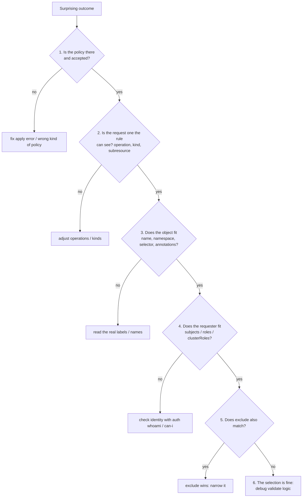

# Part 3: Debugging Why a Rule Did or Did Not Match

Two tickets arrive in every Kyverno team's queue: *"your policy is not blocking my bad Pod"* and *"your policy is blocking my good Pod"*. Both are the same question seen from two sides: **did the request fall inside the rule's selection, and if so, did the rule logic agree?** This part gives you a fixed order of checks so you stop guessing.



## Step 1: is the policy there, and was it accepted?

```sh
kubectl get clusterpolicy,policy -A
kubectl get clusterpolicy <name> -o yaml
```

Look for the three classics:

- You applied a namespaced `Policy` and expected cluster-wide effect.
- The apply printed a validation error you did not notice and the policy was never created.
- `spec.validationFailureAction` is `Audit`, so a "failing" request is admitted and only reported. Remember that `Audit` never blocks. Selection can be perfect and nothing is rejected.

## Step 2: can the rule see this request at all?

Rules only see the operations and kinds they list. Compare the **real request** with the rule:

| Symptom | Likely cause |
| --- | --- |
| Works on `kubectl apply` of a new object, silent on edits | `operations: [CREATE]` only |
| Silent on `kubectl exec` | `kinds: [Pod]` instead of `Pod/exec`, or `operations` missing `CONNECT` |
| Silent when a Deployment creates its Pods | The rule matched `Deployment` only, or `names` could not match a `generateName` Pod |
| Silent on `kubectl scale` | Subresource: needs `Deployment/scale` |

## Step 3: does the object itself fit the filter?

Read what Kyverno reads. Never trust your memory of the YAML:

```sh
kubectl get pod <name> -n <ns> --show-labels
kubectl get pod <name> -n <ns> -o jsonpath='{.metadata.annotations}'
kubectl get namespace <ns> --show-labels
```

Walk each field in the single `resources` block and keep score. Because they are ANDed, **one miss means the whole block misses**:

| Field | Check against |
| --- | --- |
| `kinds` | `kubectl api-resources` (Kind spelling, subresource) |
| `names` | The exact `metadata.name`, pattern semantics (`*` zero or more, `?` exactly one) |
| `namespaces` | The literal namespace name |
| `namespaceSelector` | Labels on the **Namespace**, not on the object |
| `selector` | Labels on the **object**, not on the Namespace |
| `annotations` | Annotations on the object, wildcard in the value only |

The single most frequent real-world cause of "my policy does nothing" is a swapped `selector`/`namespaceSelector`, a label that is on the wrong object, or a label typo (`env: prod` vs `env: production`).

## Step 4: does the requester fit?

Only needed when the rule has `subjects`, `roles` or `clusterRoles`, in `match` **or** `exclude`:

```sh
kubectl auth whoami                                   # your own identity
kubectl --as=system:serviceaccount:apps-ns:ci-deployer auth whoami
kubectl --as=system:serviceaccount:apps-ns:ci-deployer auth can-i create pods -n apps-ns
kubectl get rolebinding,clusterrolebinding -A -o wide | grep <name>
```

A group you assumed ("platform-admins") may simply not be sent by your authenticator. A ServiceAccount subject needs the namespace in the policy to match the account's real namespace. A `roles` entry needs the `<namespace>:<name>` form. Remember too that when you test as an administrator yourself, you may be a member of groups (such as `system:masters`) that your policy did not anticipate.

## Step 5: does `exclude` also match?

Exclude is silent by design: an excluded request leaves no message at all. When a rule that "should" fire does not, temporarily read the `exclude` block as its own filter and test it the same way you tested `match`. The AND-inside-one-block trap (`namespaces` and `names` together excluding only the intersection) lives here.

## A fast way to probe: server-side dry-run

You do not have to create real objects to learn what the policy does. A server-side dry-run runs the full admission chain, including Kyverno's webhook, and then stops before persisting:

```sh
kubectl run probe-1 --image=nginx -n apps-ns --labels=tier=frontend --dry-run=server
kubectl --as=system:serviceaccount:apps-ns:ci-deployer run probe-2 --image=nginx -n apps-ns --labels=tier=frontend --dry-run=server
```

Change **one** variable at a time (label, namespace, identity, name) and note which flips the result. That is a bisect of the selection. Use unique probe names so you never collide with real objects. When the answer is a rejection, read the message: it names the policy and the rule that blocked the request.

> [!TIP]
> **Try it: three tickets**
>
> In the playground, apply the policy below (it deliberately contains two mistakes), then diagnose each ticket using the order above. Do not read the explanation until you have tried.
> ```sh
> cat <<'EOF' | kubectl apply -f -
> apiVersion: kyverno.io/v1
> kind: ClusterPolicy
> metadata:
>   name: try-debug-me
> spec:
>   validationFailureAction: Enforce
>   background: false
>   rules:
>     - name: need-owner-label
>       match:
>         any:
>         - resources:
>             kinds: [Pod]
>             namespaces: [apps-ns]
>             namespaceSelector:
>               matchLabels:
>                 tier: frontend
>             operations: [CREATE]
>       exclude:
>         any:
>         - resources:
>             namespaces: [apps-ns]
>             names: ["ci-*"]
>       validate:
>         message: "Pods need an owner label."
>         pattern:
>           metadata:
>             labels:
>               owner: "?*"
> EOF
> ```
> - **Ticket 1.** "A frontend Pod with no `owner` label was admitted." Dry-run it and compare with `kubectl get ns apps-ns --show-labels`. Mistake: `tier` is a Pod label, but the rule asks the **Namespace** for it with `namespaceSelector`. It should be `selector`.
> - **Ticket 2.** "Relabeling an existing Pod to remove `owner` was allowed." Mistake: `operations: [CREATE]` leaves `UPDATE` unchecked.
> - **Ticket 3.** "Our `ci-build` Pod was never checked, but we did not ask for an exemption." Once Tickets 1 and 2 are fixed, work out why: the exclude block ANDs `namespaces: [apps-ns]` with `names: ["ci-*"]`, so every `ci-*` Pod in `apps-ns` is excluded. Exclude wins over match, silently.
>
> Fix the policy until all three tickets behave, then `kubectl delete cpol try-debug-me`.

## A short checklist to keep

1. Policy exists, is the right kind (`Policy` vs `ClusterPolicy`), and is `Enforce` if you expect blocking.
2. The operation and the kind (including subresource) are ones the rule lists.
3. Every field in the `resources` block holds for this object (remember AND).
4. The requester fits any `subjects`/`roles`/`clusterRoles`.
5. `exclude` does not also match.
6. Only then debug the `validate` pattern itself.

## Reference

- `kubectl get cpol <name> -o yaml`: the policy exactly as Kyverno holds it, including status.
- `kubectl -n kyverno logs deploy/kyverno-admission-controller`: admission controller logs, useful when a policy is not being loaded.
- The Kyverno CLI can test a policy against sample resources offline; a later section of this course introduces it.
