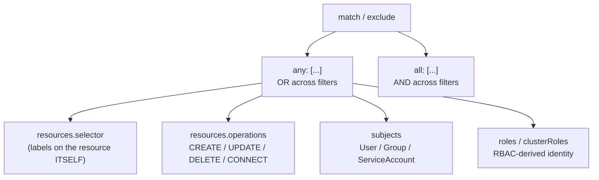

# Selecting by Identity & Operation

Kind, name, and namespace all describe *what* a resource is. This module covers the other axes of selection Kyverno gives you: the resource's **own labels** (`selector`), *what kind of write* is happening to it (`operations`), and *who* is doing the writing (`subjects`, `roles`, `clusterRoles`). It also formalizes the `any`/`all` boolean structure you've been quietly using throughout this section, since combining these axes correctly depends on understanding whether Kyverno treats a set of conditions as OR or AND.

If Module 1 was the address on the envelope, this module is the rest of the delivery slip: what the envelope says on its own face (`selector`), whether it is a new letter or an amendment (`operations`), and who handed it in at the counter (`subjects`, `roles`, `clusterRoles`).

## How this module is organised

1. **[Part 1: selector & Operations](./course-01-selector-and-operations.md)**: filtering by the matched resource's own labels (`matchLabels`, `matchExpressions`), and restricting a rule to specific admission verbs.
2. **[Part 2: subjects, roles, clusterRoles & any/all](./course-02-subjects-roles-clusterroles-and-any-all.md)**: selecting (or excluding) by requester identity, and the OR/AND combinators that tie every selection field together.
3. **[Part 3: Debugging Why a Rule Did or Did Not Match](./course-03-debugging-why-a-rule-did-or-did-not-match.md)**: a repeatable method for the "my policy does nothing" and "my policy blocks too much" tickets.
4. **[Summary](./course-04-summary.md)**: the key facts in one page.

## Learning objectives

After this module you can:

- Use `selector` to scope a rule to resources carrying specific labels (equality and set-based), and explain how it differs from `namespaceSelector`.
- Restrict a rule to specific admission operations (`CREATE`, `UPDATE`, `DELETE`, `CONNECT`) and say what happens when none is set.
- Use `subjects` to exclude (or include) requests from a specific `User`, `Group`, or `ServiceAccount`.
- Explain the difference between `subjects` and `roles`/`clusterRoles` as identity-selection mechanisms, and why identity-based rules need `background: false`.
- Read and write `match.any`/`match.all` (and the equivalent under `exclude`) and predict the OR/AND outcome for a given combination.
- Diagnose a rule that did not match, or matched too much, using dry-run probes and impersonation.

## Before you start

This module builds directly on Module 1's `kinds`/`names`/`namespaces`/`namespaceSelector`. Your playground is a kind cluster with Kyverno v1.13.2 and kubectl configured. It has an `apps-ns` namespace with two running Pods (`web-frontend` labeled `tier=frontend`, `web-backend` labeled `tier=backend`) and three ServiceAccounts to impersonate with `kubectl --as=`: `ci-deployer` (may create Pods), `auditor` (bound to the built-in `view` ClusterRole) and `ops-admin` (bound to the built-in `admin` ClusterRole). No policy exists yet.

Launch your playground now, and keep it running next to you while you read the parts:

<!-- astrona:playground -->
