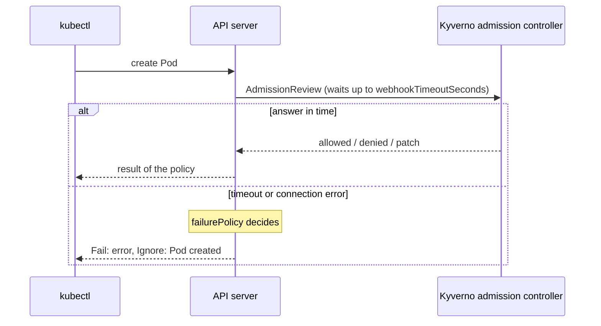

# Part 1 - failurePolicy & webhookTimeoutSeconds

## Every admission decision is a network call

When Kyverno is installed, it registers itself as a `ValidatingWebhookConfiguration` and a `MutatingWebhookConfiguration` with the Kubernetes API server. From that point on, every request that could match a live policy is paused mid-flight while the API server calls out to Kyverno over HTTPS and waits for an answer: allow, deny, or patch-and-allow.

That call can go wrong in two ordinary ways: it can take too long, or Kyverno can be completely unreachable (a rollout in progress, a crashed pod, a networking issue). Two policy-level settings decide what the API server does in either case.



Notice who owns each setting. Kyverno writes both values into the webhook configuration it registers, and the **API server** applies them. So they still work when Kyverno is not running at all, which is exactly the situation they exist for.

## webhookTimeoutSeconds: how long to wait

```yaml
apiVersion: kyverno.io/v1
kind: ClusterPolicy
metadata:
  name: require-app-label-strict
spec:
  webhookTimeoutSeconds: 5
  failurePolicy: Fail
  validationFailureAction: Enforce
  rules: [ ... ]
```

`spec.webhookTimeoutSeconds` sets how many seconds the API server will wait for Kyverno's response before treating the call as failed. It defaults to `10` and the allowed range is `1` to `30`. A value outside the range is rejected when you apply the policy.

A shorter timeout makes your cluster more responsive to a genuinely stuck webhook (it fails fast instead of making every `kubectl apply` in the cluster hang), but it also makes a policy more sensitive to ordinary latency spikes: a momentarily busy Kyverno pod might get treated as "failed" even though it would have answered a second later. A longer timeout does the opposite. Think of it as the size of the window in which a slow-but-alive Kyverno still gets to answer normally.

The timeout is also a budget for the request as a whole, not just for your policy. Kyverno evaluates every matching policy inside one webhook call, so a policy with expensive API calls (`context` entries that query the cluster) eats into the time every other policy has.

## failurePolicy: what happens after a timeout or an unreachable webhook

```yaml
spec:
  failurePolicy: Fail    # or: Ignore
```

`spec.failurePolicy` decides what the API server does once it has given up waiting (or the connection itself failed):

| Value | Behavior | Common name |
| --- | --- | --- |
| `Fail` (default) | The request is **denied** | "fail closed" |
| `Ignore` | The request is **admitted anyway**, as if the policy didn't exist for that one request | "fail open" |

How does one policy get its own failure mode when Kyverno has only one webhook configuration? Kyverno splits the rules into **separate webhook entries by `failurePolicy`** (and by timeout) inside the configuration it registers, so each entry carries its own value for the API server. You can see this yourself with `kubectl get validatingwebhookconfiguration kyverno-resource-validating-webhook-cfg -o yaml` once a policy of each kind exists: look at the `failurePolicy` and `timeoutSeconds` fields on each entry under `webhooks`. The exact entry names vary between versions, so read the fields, not the names.

This is a real operational tradeoff, not a cosmetic setting:

- **`Fail`** is the safer choice for a security-critical guardrail. You would rather block deployments during a Kyverno outage than let one unvetted resource slip through. But an outage or overload in Kyverno's admission controller can then escalate into blocking *every* matching admission request, including ones that have nothing to do with the policy's original intent.
- **`Ignore`** keeps the cluster available even if Kyverno is down, at the cost of silently disabling enforcement for the duration of the outage: no error, no warning, just requests going through as if the policy were never applied.

A rule of thumb for choosing:

| Question | Leans toward |
| --- | --- |
| Would one bad resource getting through be a security incident? | `Fail` |
| Is the policy a convention (labels, naming, cost tags)? | `Ignore` |
| Does the policy match something every team needs all day (Pods, Deployments)? | think hard before `Fail` |
| Does it match something rare (Namespaces, ClusterRoleBindings)? | `Fail` is cheap |

Two reasoning habits help. First, `failurePolicy` only matters when something is wrong with Kyverno, so you cannot see its effect in normal operation, which is why the lab asks you to prove the *same* enforcement under both settings first. Second, an `Ignore` policy that is quietly offline is invisible, so pair it with the background scan and `PolicyReport` results, which can still reveal what slipped through.

> [!WARNING]
> **Common pitfall**
>
> Setting `failurePolicy: Fail` on every policy in a cluster with no thought to Kyverno's own availability can turn a routine Kyverno upgrade or a resource-starved node into a cluster-wide outage of unrelated workloads. A common middle ground is `Fail` for a small number of genuinely critical guardrails, with sensible resource requests and limits, and several replicas of Kyverno's admission controller so that the failure window stays small.

> [!WARNING]
> **Second pitfall: the two settings are not a pair**
>
> `webhookTimeoutSeconds` does not make a policy "fail faster" on its own; it only moves the moment at which `failurePolicy` takes over. A `5` second timeout on an `Ignore` policy means requests pause up to five seconds and are then let through.

> [!TIP]
> **Try it - exploratory, not graded**
>
> This is worth seeing with your own eyes, but it is timing-sensitive and is *not* checked by the lab's validation script: do it purely to build intuition, then restore the deployment before moving on.
>
> ```sh
> kubectl -n kyverno get deployment kyverno-admission-controller
> kubectl -n kyverno scale deployment kyverno-admission-controller --replicas=0
> ```
> With the admission controller scaled to zero, try creating a Pod that should be blocked by a `failurePolicy: Fail` policy. Expect it to be rejected with an error about calling the webhook (fail closed), even though Kyverno itself isn't running to evaluate it. Now try the same against a `failurePolicy: Ignore` policy and expect it to be admitted (fail open).
>
> Afterwards, restore the deployment to its original replica count:
> ```sh
> kubectl -n kyverno scale deployment kyverno-admission-controller --replicas=<original-count>
> kubectl -n kyverno rollout status deployment/kyverno-admission-controller
> ```

> [!TIP]
> **Try it - read the registered webhooks**
>
> With one `Fail` policy and one `Ignore` policy applied, run:
> ```sh
> kubectl get validatingwebhookconfiguration kyverno-resource-validating-webhook-cfg \
>   -o jsonpath='{range .webhooks[*]}{.name}{"  "}{.failurePolicy}{"  "}{.timeoutSeconds}{"\n"}{end}'
> ```
> Expect to find entries with both failure policies, each with the timeout you configured. The `webhooks` helper in the playground guide prints the same thing.

## Reference

- `kubectl explain clusterpolicy.spec.failurePolicy`
- `kubectl explain clusterpolicy.spec.webhookTimeoutSeconds`
