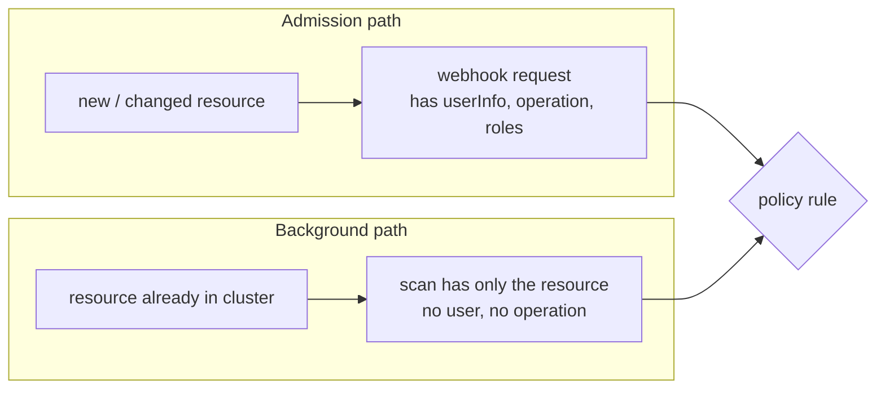

# Part 2 - schemaValidation & Policy-wide background

## Two checks, two different targets

It helps to separate two checks that both sound like "validation":

| Check | Looks at | When |
| --- | --- | --- |
| The policy's own validation | The `ClusterPolicy` YAML you apply | Once, when you `kubectl apply` the policy |
| A `validate` rule | The resources the policy matches | Every admission request, and background scans |

Kyverno always runs its own checks on a policy when you apply it. It rejects an unknown field name, a rule with both `validate` and `mutate`, a rule with no `match`, a variable that is not allowed, and so on, with a message that names the problem. That is why a typo such as `validationFailureAction: Enforse` fails at apply time instead of silently doing nothing. Nothing you set in this part turns those checks off.

## schemaValidation: one specific extra check

```yaml
apiVersion: kyverno.io/v1
kind: ClusterPolicy
metadata:
  name: example
spec:
  schemaValidation: true   # historical default
  rules: [ ... ]
```

`spec.schemaValidation` is the switch for one extra step of that apply-time check: Kyverno compares what your `mutate` and `generate` rules would produce against the OpenAPI schema of the target resource kind, so a patch that writes a field the kind does not have, or a value of the wrong type, can be caught when the policy is applied instead of when the first resource is admitted. It defaults to `true`.

Setting it to `false` skips that schema comparison. In practice it shows up as a workaround when a policy targets a custom resource or a very new field whose schema Kyverno cannot see yet. Two things stay true either way:

- It never changes enforcement. `validationFailureAction`, `failurePolicy`, the `pattern` or `deny` logic and `webhookTimeoutSeconds` behave identically with it on or off.
- It is not a way to relax how strictly a policy validates *other resources*.

> [!NOTE]
> Kyverno has been changing how it checks policies from release to release, and newer releases mark this field as deprecated. Treat it as a field you should recognise and normally leave alone, and run `kubectl explain clusterpolicy.spec.schemaValidation` on your cluster to see what its own description says. Do not build a design that depends on it.

> [!WARNING]
> **Common pitfall**
>
> `schemaValidation: false` is sometimes mistaken for a way to make a policy "less strict". It does nothing of the sort. Setting it to `false` only removes a safety net around the policy YAML you are applying; the validate logic inside your rules works exactly the same.

> [!TIP]
> **Try it - break a policy on purpose**
>
> In the playground, apply a policy with a typo in a field name, for example `validationFailureAction: Enforse` or `webhookTimeoutSeconds: 31`. Read the error: it comes from the webhook that validates policies, before any resource is involved. Fix the typo and apply again. Then check `kubectl get clusterpolicy` and notice the broken policy never got created.

## background, revisited as a deliberate setting

`spec.background` is the switch that makes Kyverno periodically re-scan resources that already exist, independent of admission control, and write the results into policy reports. Here it is as one of the "common settings" you configure on every policy.

```yaml
spec:
  background: true   # default
```



The two paths feed the same rule, but they do not carry the same data. An admission request carries who is calling (`request.userInfo`, `request.roles`, `request.clusterRoles`, the service account name) and what the call was (`request.operation`). A background scan has only the resource as it sits in the cluster; nobody is calling anything.

So a rule that depends on the caller cannot be evaluated by a scan. Kyverno protects you from the worst case: it checks policies that use caller-only variables such as `request.userInfo` with `background: true` and rejects them at apply time with a message that tells you to set `background: false`. Rules that read `request.operation` also belong in this group in spirit, because a scan has no operation to look at, and the safe move is the same.

Setting `background: false` is the honest signal: "this rule is admission-only by design." It also saves the background controller the work of re-evaluating something it can never check, and it means that policy produces no background report entries for those rules.

When you do want a rule to run only as a background scan, the next part shows the companion switch, `admission`.

## What background changes in the reports

The setting decides which source can write results for the policy. With `background: true`, a rule produces results from admission and from the background scan, and a scan covers resources that exist before the policy. With `background: false`, the rule runs only at admission. Resources that existed before the policy have no result for it, and the reports show nothing for them. This is correct for a rule that needs a caller, but it means that a cluster owner cannot use reports to find old violators of that rule.

| `background` | Rule can use caller data | Old resources get a result | Scan work for the controller |
| --- | --- | --- | --- |
| `true` | No | Yes | Yes |
| `false` | Yes | No | None |

The cost side matters on large clusters. Each scan evaluates every resource that the policy matches. A policy with a broad `match` and `background: true` makes the reports controller evaluate every matching object on every scan. Narrow the `match` to the kinds and namespaces you care about before you rely on the scan.

> [!TIP]
> **Rule of thumb**
>
> If a rule's logic references the caller (`request.userInfo`, `request.roles`, `request.clusterRoles`) or `request.operation`, set `background: false` on the policy. If the rule only ever inspects fields that live permanently on the resource (labels, spec fields, annotations), leave `background: true`: scanning and `PolicyReport` results then work as expected, and a rule you add later in Audit mode gets a report for free.

> [!TIP]
> **Try it - background: true meets userInfo**
>
> Apply a policy with a `validate` message or a `deny` condition that uses `{{ request.userInfo.username }}` and leave `background` unset. Read the error. Then add `background: false` to the policy and apply it again; expect it to be accepted. Which fields were you able to keep using with `background: true`? Try `{{ request.object.metadata.name }}`.

## Reference

- `kubectl explain clusterpolicy.spec.schemaValidation`
- `kubectl explain clusterpolicy.spec.background`
