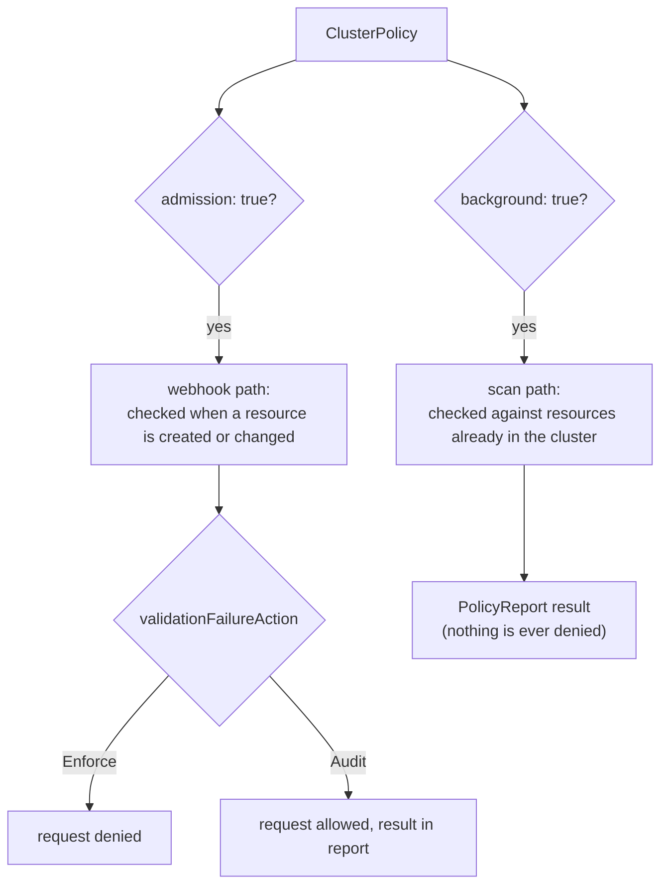

# Part 3 - admission, validationFailureAction & emitWarning

Parts 1 and 2 covered what happens when Kyverno cannot answer and how a policy checks itself. This part puts the remaining policy-wide switches side by side, because in real policy sets they are read together: **where does the policy run** (`admission`, `background`), **what does a violation cost** (`validationFailureAction`), and **who gets told** (`emitWarning`).



## admission: switch the webhook path on or off

```yaml
spec:
  admission: true     # default
  background: true    # default
```

`spec.admission` defaults to `true` and means "evaluate this policy when the API server sends an admission request". `spec.background` means "evaluate it when the background controller scans existing resources". The two are independent switches:

| admission | background | What you get |
| --- | --- | --- |
| `true` | `true` | Default. Checked at admission and re-checked by scans |
| `true` | `false` | Admission only. Needed for rules that use caller data (Part 2) |
| `false` | `true` | Scan only. Nothing is ever blocked; existing resources get report results |
| `false` | `false` | Policy does nothing; Kyverno will complain at apply time |

A scan-only policy is a clean way to ask "how bad is it?" in a cluster you do not yet dare to enforce on. It also takes the policy completely out of the admission path, which means it cannot cause a webhook timeout or a `failurePolicy` problem for anyone.

## validationFailureAction: Enforce or Audit

You have used this since Section 010, so this is a recap with the pieces in one place.

```yaml
spec:
  validationFailureAction: Enforce      # or Audit (default)
  validationFailureActionOverrides:
    - action: Audit
      namespaces:
        - sandbox
```

- `Enforce` denies a non-compliant request at admission.
- `Audit` lets it through and records the violation in a `PolicyReport` (or `ClusterPolicyReport`).
- `validationFailureActionOverrides` changes the action for chosen namespaces, so one policy can be strict in production and soft in a sandbox.
- It only affects `validate` rules. `mutate` and `generate` rules ignore it.

Remember where `failurePolicy` fits in: `validationFailureAction` decides what a *healthy* Kyverno does with a violation; `failurePolicy` decides what the API server does when Kyverno *cannot answer*. A policy can be `Audit` and `failurePolicy: Fail` at the same time, which is a bit odd, because an Audit policy never denies for violations, but would still deny every matching request during an outage. If you choose `Audit` because you do not want the policy to stop anything, `Ignore` is usually the matching choice for `failurePolicy`.

> [!NOTE]
> Newer Kyverno releases also accept the action on the individual `validate` rule and mark the policy-level field as deprecated. The policy-level form used throughout this course keeps working in v1.13. Check `kubectl explain clusterpolicy.spec.validationFailureAction` on your cluster to see what it says.

## emitWarning: tell the client, even when you do not block

An `Audit` policy lets the request through, so the person running `kubectl apply` sees nothing at all, and the violation lives only in a report that nobody may be reading. Kubernetes has a response channel for exactly this case: admission **warnings**, the `Warning:` lines `kubectl` prints under a successful command. Kyverno's `emitWarning` setting asks it to put audit violations into that channel.

```yaml
spec:
  validationFailureAction: Audit
  emitWarning: true
```

The effect to expect is that the request is still admitted, and the client now also receives a warning with the rule's message. This is a cheap way to roll out a new policy: users learn about the rule when they run into it, nothing breaks, and the reports still collect the numbers. The field has moved around between releases, so before you rely on it run `kubectl explain clusterpolicy.spec.emitWarning` (and look under `validate` if the policy-level field is not listed) to confirm where your Kyverno version puts it.

## Putting the settings together

A policy for a convention you want to roll out gently might look like this:

```yaml
spec:
  validationFailureAction: Audit
  failurePolicy: Ignore
  webhookTimeoutSeconds: 5
  admission: true
  background: true
```

A policy for a rule that must never be broken:

```yaml
spec:
  validationFailureAction: Enforce
  failurePolicy: Fail
  webhookTimeoutSeconds: 10
  admission: true
  background: true
```

A policy that depends on the caller:

```yaml
spec:
  validationFailureAction: Enforce
  background: false
```

> [!WARNING]
> **Common pitfall**
>
> Reading a clean `PolicyReport` as proof that a rule is enforced. A report only shows what a scan or an admission evaluated. If the policy is `failurePolicy: Ignore`, and Kyverno was down while a resource was created, that resource may never have been evaluated at admission. A background scan will catch it later only if `background` is `true`.

> [!TIP]
> **Try it - one policy, three modes**
>
> Write one `require-app-label` policy for the `sandbox` namespace and apply it three times with small changes, using `try_pod sandbox` (no label) each time: first `Enforce`, then `Audit` with `emitWarning: true`, then `Audit` with `admission: false`. Predict the result before you run each one. Check `kubectl get policyreport -n sandbox` after the scan-only version has had a minute to run, and compare it with what the admission-only version recorded.

## Reference

- `kubectl explain clusterpolicy.spec.admission`
- `kubectl explain clusterpolicy.spec.validationFailureAction`
- `kubectl explain clusterpolicy.spec.emitWarning`
