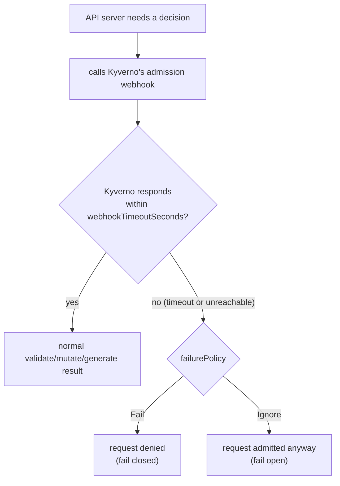

# Policy-Level Settings: failurePolicy, Timeouts & Schema Validation

A Kyverno policy does not run in a vacuum. Every time the API server needs a decision from Kyverno's admission webhook, it is making a network call, and network calls can be slow, or they can fail outright. This module covers the settings that decide what happens at the edges of that call: how long the API server waits, what it does if Kyverno never answers, and how a policy declares where and when it runs at all.

None of these settings change what a rule *matches* or what it *does* to a resource. They change how resilient, or how strict, the policy is as a piece of live cluster infrastructure.

## How this module is organised

1. **[Part 1 - failurePolicy & webhookTimeoutSeconds](./course-01-failurepolicy-and-webhooktimeoutseconds.md)** - what happens when Kyverno can't answer in time, and how long the API server is willing to wait.
2. **[Part 2 - schemaValidation & Policy-wide background](./course-02-schemavalidation-and-policy-wide-background.md)** - the `schemaValidation` field, and `background` as a setting you configure on purpose.
3. **[Part 3 - admission, validationFailureAction & emitWarning](./course-03-admission-validationfailureaction-and-emitwarning.md)** - the switches that decide where a policy runs and what a violation costs, put side by side.
4. **[Summary](./course-04-summary.md)** - what to remember.

## Learning objectives

After this module you can:

- Explain the difference between `failurePolicy: Fail` (fail closed) and `failurePolicy: Ignore` (fail open), and pick the right one for a given policy's risk profile.
- Explain what `webhookTimeoutSeconds` controls, and its default and maximum values.
- Explain what `schemaValidation` is for, and why it does not relax enforcement.
- Decide when a policy should set `background: false` because its logic depends on admission-only request data.
- Combine `admission`, `background` and `validationFailureAction` to make a policy enforcing, reporting-only, or admission-only.

## Before you start

This module assumes you're comfortable applying `ClusterPolicy` resources and reading their `spec` (Section 010). The playground and the linked lab give you a kind Kubernetes cluster with `kubectl` already configured and Kyverno v1.13.2 already installed.

Launch the playground now and keep it running next to you while you read. It has Kyverno, the empty namespaces `critical-ns`, `lenient-ns` and `sandbox`, and no policies. Every "Try it" box in the parts works there.

<!-- astrona:playground -->
