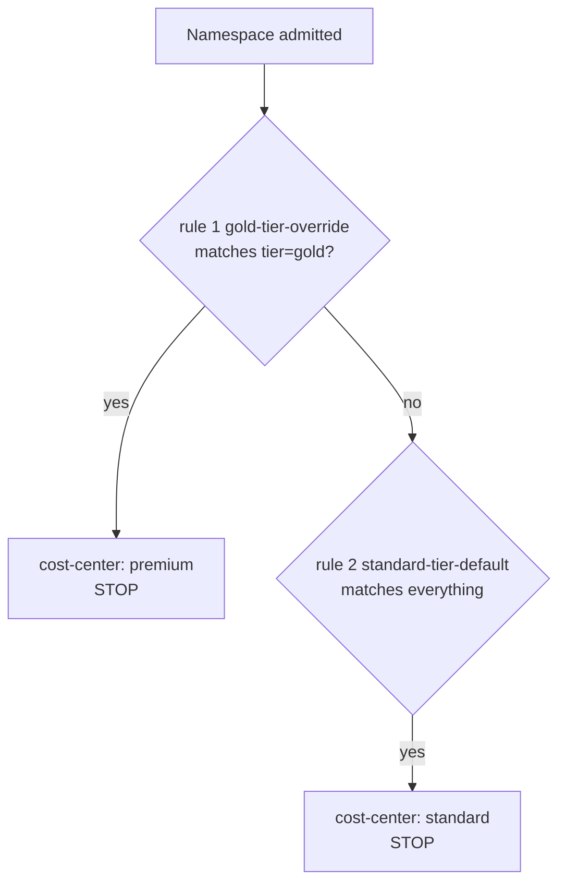

# Part 1 - applyRules: All vs One

## The default: every matching rule runs

A `ClusterPolicy` or `Policy` can carry more than one rule under `spec.rules`. By default, Kyverno evaluates every rule independently against a given resource. If three rules all match, all three run, cumulatively.

That default is `spec.applyRules: "All"`, and you rarely need to write it out because it is already the behavior you get. It is the right model whenever your rules are additive: a label-adding mutate rule and a resource-limit validate rule on the same Pod are two independent checks that should both apply if both match.

## applyRules: "One" - stop after the first match

```yaml
apiVersion: kyverno.io/v1
kind: ClusterPolicy
metadata:
  name: label-namespace-by-tier
spec:
  applyRules: "One"
  rules:
    - name: gold-tier-override
      match:
        any:
        - resources:
            kinds:
              - Namespace
            selector:
              matchLabels:
                tier: gold
      mutate:
        patchStrategicMerge:
          metadata:
            labels:
              cost-center: premium

    - name: standard-tier-default
      match:
        any:
        - resources:
            kinds:
              - Namespace
      mutate:
        patchStrategicMerge:
          metadata:
            labels:
              cost-center: standard
```

Some rule lists are not additive. They are a priority-ordered decision tree, where you want exactly *one* outcome, not a cumulative stack. That is what `applyRules: "One"` is for: Kyverno evaluates `spec.rules` in order and stops as soon as the first rule whose `match` (and `exclude`) actually selects the resource has run. Every rule after that is skipped for this resource, even if it would otherwise have matched too.



In the example, a `Namespace` labeled `tier: gold` matches both rules: `gold-tier-override` because of its label selector, and `standard-tier-default` because it matches every `Namespace`. With `applyRules: "One"`, only `gold-tier-override` runs (it is listed first and it matches), so the namespace gets `cost-center: premium` and never also gets `cost-center: standard` from the fallback. A `Namespace` with no `tier` label does not match the first rule at all, so Kyverno falls through to `standard-tier-default`. That is the switch/case behavior a plain rule list cannot express on its own.

## What "All" would do with the same policy

Take away `applyRules: "One"` and both rules match the gold namespace. Both run, in rule order, and both write the same label key, `cost-center`. Because the rules run one after the other on the same object, the later patch is applied on top of the earlier one, so the standard rule would overwrite premium. The result looks like a bug in the *first* rule while the actual cause is the *second* one still running. This is the most common reason to reach for `applyRules: "One"`: two rules that write the same field.

If you only need two rules not to fight, there are other options (a precondition on the catch-all that excludes gold, or `exclude` on it). `applyRules: "One"` is the shortest, and the order of the list documents the priority.

## Where it applies

- `applyRules` is a **policy-level** field. It counts rules *inside this one policy* only. Rules in other policies still run.
- It is designed for lists of `validate` and `mutate` rules that are alternatives to each other. Do not use it to order `generate` rules; give those separate policies.
- "First" means first in the `spec.rules` list **that matches**. A rule that does not match the resource is not "used up".
- The ordering is not alphabetical and not by rule name. It is the order you wrote.

> [!TIP]
> **Try it - order matters**
>
> With `applyRules: "One"`, rule order inside `spec.rules` is not cosmetic: it is the priority list. Put a narrow, specific rule (like the gold-tier override) before a broad catch-all rule, the same way you would order `case` branches from most specific to a final `default`. Reversing the order in the example would mean the catch-all always wins, since it matches everything and is now evaluated first.

> [!TIP]
> **Try it - same policy, with and without One**
>
> In the playground, apply the policy above, label `team-a` with `tier=gold` and run `kubectl get ns -L tier,cost-center`. Expect `premium` on `team-a`. Create a namespace `team-e` without a tier and expect `standard`. Now delete the `applyRules` line, re-apply, remove the `cost-center` label from `team-a` and re-apply the tier label. Which value does it carry now, and why?

> [!WARNING]
> **Common pitfall**
>
> `applyRules: "One"` only decides *how many rules in this policy run* against a given resource. It has no effect at all on how many separate *policies* apply: every other `ClusterPolicy`/`Policy` in the cluster that matches the resource still runs normally, regardless of this setting.

> [!WARNING]
> **Second pitfall: mutation is not undone**
>
> A mutate rule runs when the resource is created or updated. If `team-a` gets `tier=gold` later and then the label is removed, nothing removes `cost-center: premium`. `applyRules` chooses between rules at the moment they run; it does not keep labels in sync with their cause.

## Reference

- `kubectl explain clusterpolicy.spec.applyRules`
