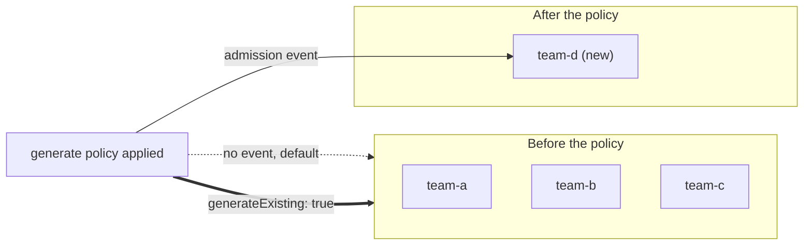

# Part 2 - generateExisting & mutateExistingOnPolicyUpdate

## The default: generate and mutate only look forward

A `generate` rule fires when a matching **trigger** resource is admitted, a new `Namespace` being created, for example. That is the mechanism you used in Section 010 to clone a `ConfigMap` or a default-deny `NetworkPolicy` into every namespace. But notice the phrasing: it fires on a trigger resource *being admitted*. By default, a `generate` rule has nothing to say about trigger resources that were already sitting in the cluster before the policy existed. They were admitted long before this policy was applied, so there was no admission event for the rule to react to.

The same forward-only default applies to `mutate` rules: they patch a resource as it is admitted (created or updated), not resources that already exist and are not being touched right now.



## generateExisting: true - populate the backlog retroactively

```yaml
apiVersion: kyverno.io/v1
kind: ClusterPolicy
metadata:
  name: clone-default-netpol
spec:
  generateExisting: true
  rules:
    - name: clone-netpol-to-namespace
      match:
        any:
        - resources:
            kinds:
              - Namespace
      exclude:
        any:
        - resources:
            namespaces:
              - kube-system
              - kyverno
              - kube-node-lease
              - kube-public
              - local-path-storage
      generate:
        apiVersion: networking.k8s.io/v1
        kind: NetworkPolicy
        name: default-deny-ingress
        namespace: "{{request.object.metadata.name}}"
        synchronize: true
        data:
          spec:
            podSelector: {}
            policyTypes:
              - Ingress
```

Setting `generateExisting: true` on the policy tells Kyverno to also run this generate logic against trigger resources that already existed at the moment the policy was created or updated, not just resources created afterward. Applying the policy above immediately backfills the default-deny `NetworkPolicy` into every namespace that was already there, in addition to every namespace created from then on.

Read the YAML piece by piece:

- `match` names the **trigger**: every `Namespace`.
- `exclude` keeps the system namespaces out. A default-deny ingress policy in `kube-system` or in Kyverno's own namespace is a good way to break the cluster.
- `generate.namespace` uses `{{request.object.metadata.name}}` so each trigger namespace receives its own copy.
- `synchronize: true` makes the generated object follow the policy: if someone deletes or edits it, Kyverno puts it back, and if the policy goes away the generated objects go with it.

> [!NOTE]
> In this course the field is written at the top of `spec`, as above. Kyverno has been moving the field next to the rule it affects (look for `generateExisting` under `generate`) and treats the policy-level form as deprecated, but still accepts it in v1.13. Run `kubectl explain clusterpolicy.spec.generateExisting` and `kubectl explain clusterpolicy.spec.rules.generate` on your cluster to see which forms it lists.

This matters most exactly when you would expect: rolling out a new cluster-wide guardrail onto a cluster that already has dozens of namespaces. Without `generateExisting: true`, the new policy would only ever apply to namespaces created after today, leaving every pre-existing namespace silently uncovered until someone notices and patches them by hand.

The backfill is not instant and not part of an admission request. It is done by the **background controller**, so give it a few seconds, and when it does not happen, look at that controller's logs (`kubectl -n kyverno logs deploy/kyverno-background-controller`) before you suspect the policy. Part 3 returns to this.

## mutateExistingOnPolicyUpdate - the same idea, for mutate

```yaml
apiVersion: kyverno.io/v1
kind: ClusterPolicy
metadata:
  name: relabel-existing-deployments
spec:
  mutateExistingOnPolicyUpdate: true
  rules:
    - name: add-managed-by-label
      match:
        any:
        - resources:
            kinds:
              - Deployment
      mutate:
        targets:
          - apiVersion: apps/v1
            kind: Deployment
            namespace: "*"
        patchStrategicMerge:
          metadata:
            labels:
              managed-by: platform-team
```

A normal `mutate` rule only ever patches the resource that triggered admission, the one being created or updated right now. A `mutate` rule that instead uses a `targets` block (naming another kind or scope of resource to patch) is called **mutate existing**: it patches objects that already exist, rather than the one in the admission request. Combined with `mutateExistingOnPolicyUpdate: true`, it tells Kyverno: whenever this policy itself is created or updated, go find every resource matching `targets` right now and patch it too, not just resources admitted going forward.

This is the `mutate` equivalent of `generateExisting`: instead of only fixing up what happens next, it reaches back and repairs the resources that are already there, at the moment you roll the policy out (or change it).

| | `generateExisting` | `mutateExistingOnPolicyUpdate` |
| --- | --- | --- |
| Applies to | `generate` rules | `mutate` rules with `targets` |
| Fires when | The policy is created or updated | The policy is created or updated |
| Acts on | Existing trigger resources | Existing `targets` resources |
| Result | Generated objects appear | Existing objects are patched |

> [!NOTE]
> As with `generateExisting`, newer Kyverno releases also accept this flag on the `mutate` block of the rule. Check `kubectl explain clusterpolicy.spec.mutateExistingOnPolicyUpdate` for the form your version lists.

> [!TIP]
> **Conceptual walkthrough - exploratory, not part of this lab's graded task**
>
> Imagine a cluster with fifty existing Deployments, none carrying a `managed-by` label. You write the policy above with `mutateExistingOnPolicyUpdate: true` and a `targets` block matching `apps/v1, Deployment` in every namespace. The moment you `kubectl apply` it, Kyverno does not wait for someone to touch those fifty Deployments: it walks the existing set matching `targets` and patches them. Editing the policy later (say, changing the label value) triggers the same sweep again, since it fires "on policy update", not just "on policy create".

> [!TIP]
> **Try it - backfill in the playground**
>
> The playground has a Deployment `web` in `team-a` and `team-b`. Apply the policy above and run `kubectl get deploy web -A --show-labels`. Give it a few seconds and run it again. Then change the label value in the policy, re-apply, and watch the value change on both Deployments. If nothing happens, see Part 3.

> [!WARNING]
> **Common pitfall**
>
> `generateExisting` and `mutateExistingOnPolicyUpdate` are two different fields for two different rule types: one only means something on `generate` rules, the other only means something on `mutate` rules using a `targets` block. Setting `generateExisting: true` on a policy that only has `mutate` rules (or the other way around) does nothing at all; there is no cross-wiring between the two mechanisms.

> [!WARNING]
> **Second pitfall: ordinary mutate rules are still forward-only**
>
> `mutateExistingOnPolicyUpdate` does nothing for an ordinary `patchStrategicMerge` rule without `targets`. Such a rule patches the resource in the admission request, so existing objects get the change only when something updates them, for example the next `kubectl apply`.

## Reference

- `kubectl explain clusterpolicy.spec.generateExisting`
- `kubectl explain clusterpolicy.spec.mutateExistingOnPolicyUpdate`
