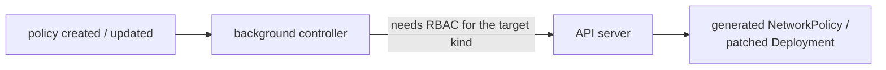

# Part 3 - Backfilling safely: permissions, synchronize & rollout

Turning on `generateExisting` or `mutateExistingOnPolicyUpdate` is a bulk change to a live cluster, made by a controller, with no admission request to show you the result. This part covers what has to be true for it to work, and how to roll it out without surprises.

## Who does the work: the background controller

Admission-time work happens in the admission controller. A backfill does not: there is no request to answer. Kyverno hands the work to the **background controller**, which creates generated objects and patches mutate targets using its own service account. Two consequences follow.

1. **It needs permission.** The background controller only has the rights Kyverno's own ClusterRoles grant it. If a policy generates or patches a kind it cannot write, the backfill does not happen, and the failure appears as controller logs and as an error in the policy's `status`, not as an error in your `kubectl apply`. Kyverno builds the controller's rights from ClusterRoles that carry an aggregation label, so you add rights by creating a ClusterRole with the label `rbac.kyverno.io/aggregate-to-background-controller: "true"` and the verbs it needs (`create`, `update`, `get`, `list`, `delete` for generate; `get`, `list`, `patch`, `update` for mutate-existing). The playground bootstrap does exactly that.
2. **It is asynchronous.** The policy is `Ready` before the backfill finishes. A validation that runs immediately after `kubectl apply` can see nothing yet. Poll for the result instead of reading it once.

## Reading the result of a backfill

- `kubectl get networkpolicy -A` or `kubectl get cm -A` to see what was generated.
- `kubectl get deploy -A --show-labels` to see what was mutated.
- `kubectl describe clusterpolicy <name>` for status conditions.
- `kubectl -n kyverno logs deploy/kyverno-background-controller --tail=100` for permission and rule errors.
- `kubectl get updaterequests -A` can show pending work in Kyverno's queue while a backfill runs. If the list stays long, the controller is stuck on something.

A generated object also carries labels that point back at the policy and rule that created it, so `kubectl get <kind> -A --show-labels` tells you which objects a policy owns. If you want to know exact label names, read them off one object rather than relying on memory.

## synchronize: keep generated objects honest

`synchronize: true` on a generate rule makes the policy the source of truth for what it generated:

| Event | With `synchronize: true` | With `synchronize: false` |
| --- | --- | --- |
| Someone edits or deletes the generated object | Kyverno restores it | The change stays |
| The `data` in the policy changes | Generated objects are updated | Old ones stay as they were |
| The policy is deleted | Generated objects are deleted | Generated objects stay |

For a guardrail such as default-deny ingress, `true` is almost always what you want. For a starter object that a team may take over and edit (a template `ConfigMap`), `false` lets them. Note the last row: with `synchronize: true`, deleting the policy deletes everything it generated, in every backfilled namespace, so treat that delete as a bulk operation.

## Rolling out a backfill on a real cluster

1. **Read the match first.** Count what `match` selects: `kubectl get ns | wc -l`, `kubectl get deploy -A | wc -l`. A `targets` block with `namespace: "*"` is every Deployment in the cluster.
2. **Exclude what must not be touched.** System namespaces first; then anything managed by another tool (a GitOps controller will fight a label you add).
3. **Try it narrow.** Start with `match` or `targets` restricted by a label or a single namespace, check the result, then widen.
4. **Check permissions** before you apply (see above) and look at the controller logs a minute after.
5. **Know the undo.** For `synchronize: true`, deleting the policy removes what was generated. A mutate-existing patch is not undone by deleting the policy, because a patch is a change to the object. You would write a second rule that sets the label back, or remove it by hand.
6. **Remember that updates re-run it.** Every edit to the policy runs the sweep again, so a harmless-looking edit on a policy that matches thousands of objects is a bulk change.

> [!WARNING]
> **Common pitfall**
>
> Applying a backfill policy, seeing `kubectl get clusterpolicy` report `Ready`, and concluding it worked. Ready means the policy is accepted, not that the sweep finished or that the background controller was allowed to do it. Always check the generated or patched objects themselves.

> [!TIP]
> **Try it - break the permission on purpose**
>
> In the playground, delete the ClusterRole `ats010-background-controller-extra`, wait a few seconds, then apply a policy that generates a `NetworkPolicy` with `generateExisting: true`. Check `kubectl get networkpolicy -A` and the background controller log. Create the role again (the bootstrap script shows its content) and look at whether the backfill catches up when the policy is next updated.

## Reference

- `kubectl explain clusterpolicy.spec.rules.generate.synchronize`
- `kubectl -n kyverno logs deploy/kyverno-background-controller`
