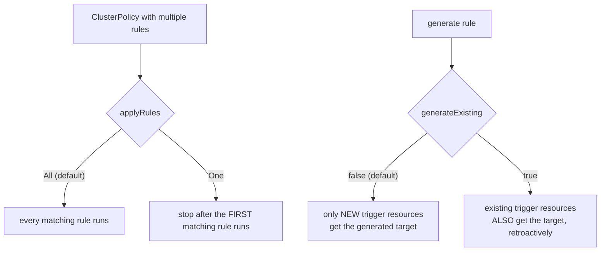

# Rule-Level Settings: applyRules, generateExisting & mutateExistingOnPolicyUpdate

This module covers settings about *what* a policy's rules actually do once they run, and two things that trip up almost everyone the first time they meet them: whether a policy's rules all run together or stop at the first match, and whether Kyverno's `generate` and `mutate` rules only ever look forward at new resources, or can also reach back and touch what is already sitting in the cluster.

## How this module is organised

1. **[Part 1 - applyRules: All vs One](./course-01-applyrules-all-vs-one.md)** - running every matching rule cumulatively vs stopping at the first match.
2. **[Part 2 - generateExisting & mutateExistingOnPolicyUpdate](./course-02-generateexisting-and-mutateexistingonpolicyupdate.md)** - making `generate` and `mutate` rules reach back and affect resources that already existed before the policy did.
3. **[Part 3 - Backfilling safely: permissions, synchronize & rollout](./course-03-backfilling-safely.md)** - what has to be true for a backfill to work, and how to plan one on a busy cluster.
4. **[Summary](./course-04-summary.md)** - what to remember.

## Learning objectives

After this module you can:

- Explain the difference between `applyRules: "All"` and `applyRules: "One"`, and identify when a policy's rules should be mutually exclusive.
- Explain why `generate` rules are forward-only by default, and what `generateExisting: true` changes.
- Explain what `mutateExistingOnPolicyUpdate` does for a `mutate` rule with a `targets` block, and how it differs from ordinary admission-time mutation.
- Name what a backfill needs to succeed (background controller permissions, a clear trigger and a safe target) and what to check afterwards.

## Before you start

You should be comfortable with `match`/`exclude` and with the three rule types (validate, mutate and generate). The playground and the linked lab give you a kind cluster with Kyverno v1.13.2 installed and namespaces that exist *before* any policy does.

Launch the playground now and keep it running next to you while you read. It has the namespaces `team-a`, `team-b`, `team-c`, a Deployment `web` in two of them, and no policies.

<!-- astrona:playground -->
