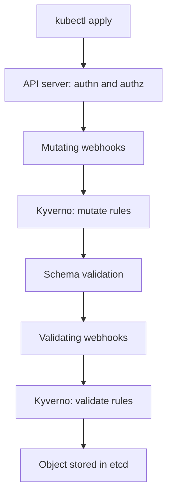

# Mutate Rules With patchStrategicMerge And patchesJson6902

Developers forget things. They forget a label that the cost report needs, and they forget to turn off privilege escalation in a container. You can reject their pods for it, but that gives them a second round of work. A `mutate` rule fixes the object while the API server is still processing the request, so the pod is created correctly the first time. This part shows the two ways Kyverno changes an object and how to prove that the change really happened.

## Where mutation happens

When you run `kubectl apply`, the request goes to the Kubernetes API server. The API server authenticates and authorizes it. Then it calls the mutating admission webhooks, which are HTTPS services that may change the object. Only after that does it check the schema and call the validating admission webhooks. Kyverno registers one webhook of each kind and runs inside its **admission controller** (the Deployment `kyverno-admission-controller`).



The diagram shows that a mutate rule always runs before the schema check and before every validate rule. The object that reaches `etcd` (the database that holds all cluster state) is the mutated object. The YAML file on your disk never changes.

## A first mutate rule: patchStrategicMerge

A strategic merge patch is a partial copy of the object. Kyverno merges it into the incoming object: fields in the patch are added or replaced, and fields that are not in the patch stay as they are. This is the same merge that `kubectl patch --type strategic` uses. The next policy gives every pod in `starfleet` an `owner` label and a safe default for `allowPrivilegeEscalation`.

Save this as `policy-pod-defaults.yaml`:

```yaml
apiVersion: kyverno.io/v1
kind: ClusterPolicy
metadata:
  name: add-pod-owner-defaults
  annotations:
    pod-policies.kyverno.io/autogen-controllers: none
spec:
  rules:
    - name: default-owner-and-privilege
      match:
        any:
          - resources:
              kinds:
                - Pod
              namespaces:
                - starfleet
      mutate:
        patchStrategicMerge:
          metadata:
            labels:
              +(owner): platform
          spec:
            containers:
              - (name): "*"
                securityContext:
                  +(allowPrivilegeEscalation): false
```

The `match` block selects pods in the `starfleet` namespace. The `mutate.patchStrategicMerge` block is the patch. Two pieces of its syntax are not plain YAML, so read them slowly.

The `+(owner)` key is an **add-if-not-present anchor**. An anchor is a key in parentheses that changes how Kyverno applies the value. With `+(...)`, Kyverno adds the field only when the object does not already have it. A pod that sets `owner: ops` keeps `ops`. A pod with no `owner` label gets `platform`. Without the plus sign, Kyverno would replace the author's value, which is almost never what a default should do.

The `(name): "*"` key is a **conditional anchor**. It says "apply this part of the patch to each element of `containers` whose `name` matches `*`", so every container is patched, whatever its name. The annotation on the policy stops Kyverno from generating the same rule for Deployments, Jobs and other pod controllers. Kyverno does that by default for rules that match `Pod`, and turning it off keeps this exercise about pods only.

Apply the policy and wait until Kyverno reports it ready:

```sh
kubectl apply -f policy-pod-defaults.yaml
kubectl get clusterpolicy add-pod-owner-defaults
```

<!-- astrona:playground:renew -->

The `READY` column of the second command shows `True` when the admission controller has registered the rule. If it shows `False`, run the command again after a few seconds.

## Proving the mutation on the stored object

The proof of a mutation is the stored object. Create a pod with no labels and no `securityContext`, and read it back. Save this as `pod-plain.yaml`:

```yaml
apiVersion: v1
kind: Pod
metadata:
  name: plain
  namespace: starfleet
spec:
  containers:
    - name: pause
      image: registry.k8s.io/pause:3.9
```

Apply it, then read the labels and the container `securityContext` from the object that the API server stored:

```sh
kubectl apply -f pod-plain.yaml
kubectl get pod plain -n starfleet -o jsonpath='{.metadata.labels}{"\n"}'
kubectl get pod plain -n starfleet -o jsonpath='{.spec.containers[0].securityContext}{"\n"}'
```

The first command prints a label list that includes `"owner":"platform"`. The second prints a `securityContext` that contains `"allowPrivilegeEscalation":false`. Your file `pod-plain.yaml` has neither, so Kyverno added both. Run `kubectl get pod plain -n starfleet -o yaml` if you want to see the whole object.

Now check that the anchor protects the author's choice. Create a pod that sets its own `owner` label and `allowPrivilegeEscalation: true`. Save this as `pod-explicit.yaml`:

```yaml
apiVersion: v1
kind: Pod
metadata:
  name: explicit
  namespace: starfleet
  labels:
    owner: ops
spec:
  containers:
    - name: pause
      image: registry.k8s.io/pause:3.9
      securityContext:
        allowPrivilegeEscalation: true
```

Apply it and read the same two fields. They must still say `ops` and `true`, because `+()` never overwrites. A mutate rule that sets a default must not take away an explicit choice; a validate rule is the right tool to forbid the choice.

## The second way: patchesJson6902

A JSON patch (the format is defined in RFC 6902) is a list of operations. Each operation has an `op` (`add`, `replace` or `remove`), a `path` to one field, and for `add` and `replace` a `value`. Kyverno takes the list as a YAML string. Use it when you need an exact operation, such as setting a field to one value whatever the author wrote, or removing a field.

Save this as `policy-no-token.yaml`:

```yaml
apiVersion: kyverno.io/v1
kind: ClusterPolicy
metadata:
  name: disable-token-automount
  annotations:
    pod-policies.kyverno.io/autogen-controllers: none
spec:
  rules:
    - name: set-automount-false
      match:
        any:
          - resources:
              kinds:
                - Pod
              namespaces:
                - starfleet
      mutate:
        patchesJson6902: |-
          - op: add
            path: /spec/automountServiceAccountToken
            value: false
```

Apply it, wait for `READY`, and create a new pod. The `automountServiceAccountToken` field controls whether Kubernetes mounts the service account token into the pod. Existing pods do not change, because a rule only runs when a request arrives.

```sh
kubectl apply -f policy-no-token.yaml
kubectl get clusterpolicy disable-token-automount
kubectl run second --image=registry.k8s.io/pause:3.9 -n starfleet
kubectl get pod second -n starfleet -o jsonpath='{.spec.automountServiceAccountToken}{"\n"}'
```

The last command prints `false`. The operation `add` sets the field to `false` even when the author wrote `true`. That is the difference between the two formats: the merge patch with `+()` supplies a default, and the JSON patch gives you a fixed result.

| Question | patchStrategicMerge | patchesJson6902 |
| --- | --- | --- |
| Shape | A partial copy of the object | A string holding a list of operations |
| Add only if missing | Yes, with the `+()` anchor | No. `add` sets the value even when one exists |
| Patch every container | Yes, with a conditional anchor | You must write an index such as `/spec/containers/0/...` |
| Remove a field | Awkward | `op: remove` |
| Fails when the parent is missing | No, the merge creates it | Yes. `add` needs the parent object to exist |

The last row is a common surprise. A path such as `/metadata/labels/owner` fails on a pod that has no labels at all, because `/metadata/labels` does not exist. Use a merge patch when you do not know whether the parent exists. Also remember that a label key with a `/` in it needs `~1` in a JSON patch path.

## Rules in one policy run in order

A policy can hold several rules. Kyverno runs the mutate rules of one policy from top to bottom, and each rule sees the object that the rule above it produced. A second rule can therefore depend on a label that the first rule added. Do not depend on the order of two different policies. Put rules that need an order in one policy.

You now know both patch formats, the add-if-not-present anchor, and how to read a mutation from the stored object. The open question is what happens when a validate rule wants the same label that a mutate rule adds, and the next part answers it.

## Common pitfalls

> [!WARNING]
> - Checking the YAML file instead of the stored object. Always read the result with `kubectl get -o`.
> - Writing `owner: platform` without `+()` and so replacing the label the author set.
> - Putting the anchor on the whole `securityContext` key. `+(securityContext)` skips the rule when the author set any `securityContext` field. Put the anchor on the single field, as above.
> - Expecting a mutate rule to change pods that already exist. It runs on a create or update request only. Existing pods stay as they are.
> - A JSON patch `add` on a path whose parent does not exist. The request fails with a patch error.
