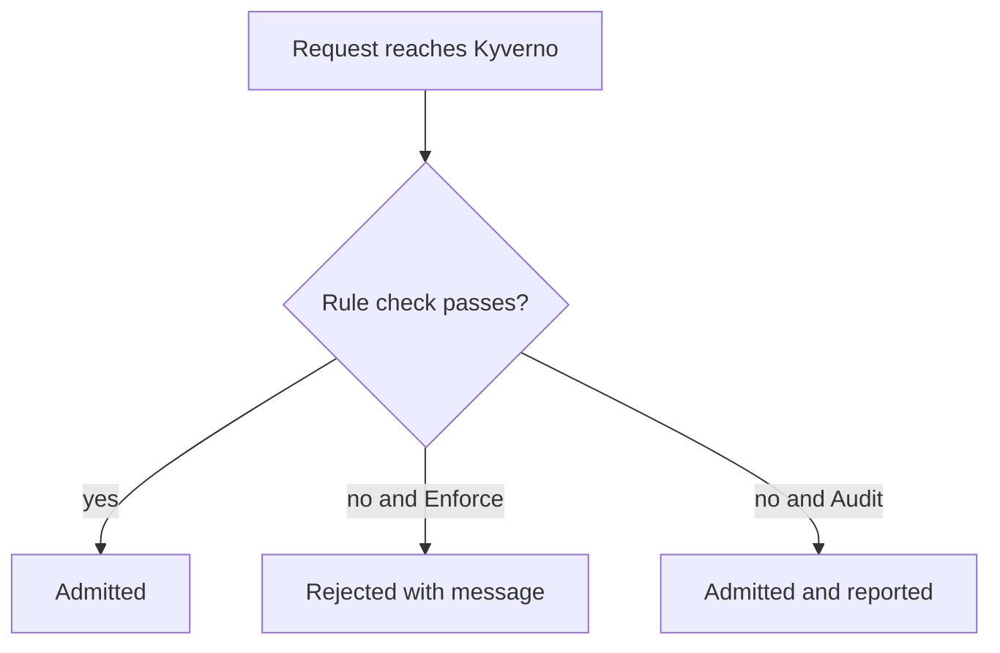

# Validate Rules, Deny Rules And Ordering

A mutate rule fills in what the author left out. A validate rule decides whether the final object is acceptable at all. This part writes both kinds of validate rule that you meet most often, a `pattern` rule that describes a good object and a `deny` rule that describes a forbidden request. It then proves, with two namespaces side by side, that mutate rules finish before validate rules start.

## The validate rule and its action

A `validate` rule checks the object against a condition and, when the check fails, allows or blocks the request. Which of the two happens is set by the policy field `validationFailureAction`. With the value `Enforce`, Kyverno rejects the request and the API server returns the rule's `message` to the user. With the value `Audit`, Kyverno admits the request and records the failure in a policy report. `Audit` is the safe value for a new policy: you see what would break before anything breaks.



The diagram shows that a passing check is always admitted, and the action only matters for failures.

## The pattern: describe the good object

A `pattern` is a partial copy of the object that shows what a valid object looks like. Kyverno compares it with the real object field by field. Two wildcards are common: `?*` matches any string with at least one character, and `*` matches any string including the empty one. A leading `!` negates a value, so `"!*:latest"` matches every image that does not end with `:latest`.

Save this as `policy-require-owner.yaml`:

```yaml
apiVersion: kyverno.io/v1
kind: ClusterPolicy
metadata:
  name: require-owner-label
  annotations:
    pod-policies.kyverno.io/autogen-controllers: none
spec:
  validationFailureAction: Enforce
  background: true
  rules:
    - name: check-owner
      match:
        any:
          - resources:
              kinds:
                - Pod
              namespaces:
                - starfleet
                - outpost
      validate:
        message: "Every pod needs a non-empty owner label."
        pattern:
          metadata:
            labels:
              owner: "?*"
    - name: no-latest-tag
      match:
        any:
          - resources:
              kinds:
                - Pod
              namespaces:
                - starfleet
                - outpost
      validate:
        message: "Images must not use the latest tag."
        pattern:
          spec:
            containers:
              - image: "!*:latest"
```

The first rule requires an `owner` label with at least one character. The second walks through the `containers` list: in a pattern, the one list element is compared with every container, so each container must satisfy it. The field `background: true` means Kyverno also scans existing pods for this policy. It is the default, and it matters later when you read reports.

Start from a clean cluster policy list, so that no earlier exercise changes the result. Then apply the new policy:

```sh
kubectl delete clusterpolicy --all
kubectl apply -f policy-require-owner.yaml
kubectl get clusterpolicy require-owner-label
```

<!-- astrona:playground:renew -->

Wait until `READY` is `True`. Then try to create a pod without an `owner` label in `outpost`:

```sh
kubectl run nolabel --image=registry.k8s.io/pause:3.9 -n outpost
```

The API server refuses the request. The error text names the policy `require-owner-label`, the rule `check-owner` and the message you wrote. Every failure message ends with the field path that did not match, so read it to the end. A pod with the label is admitted:

```sh
kubectl run labelled --image=registry.k8s.io/pause:3.9 -n outpost --labels=owner=ops
```

## Putting mutate before validate on purpose

Now add a mutate rule that supplies the missing label. Save this as `policy-owner-default.yaml`. It matches only `starfleet`, while the validate rule above matches both namespaces:

```yaml
apiVersion: kyverno.io/v1
kind: ClusterPolicy
metadata:
  name: default-owner-label
  annotations:
    pod-policies.kyverno.io/autogen-controllers: none
spec:
  rules:
    - name: add-owner
      match:
        any:
          - resources:
              kinds:
                - Pod
              namespaces:
                - starfleet
      mutate:
        patchStrategicMerge:
          metadata:
            labels:
              +(owner): platform
```

Apply it, wait until it is ready, and create the same label-less pod in both namespaces:

```sh
kubectl apply -f policy-owner-default.yaml
kubectl get clusterpolicy default-owner-label
kubectl run nolabel-a --image=registry.k8s.io/pause:3.9 -n starfleet
kubectl run nolabel-b --image=registry.k8s.io/pause:3.9 -n outpost
```

The pod in `starfleet` is admitted, even though the command has no `owner` label, because the mutate rule added `owner: platform` before the validate rule ran. The pod in `outpost` is rejected, because no mutate rule matches there. Read `kubectl get pod nolabel-a -n starfleet --show-labels` to see the label that Kyverno added.

This is the point of the ordering. If validate ran first, the `starfleet` pod would fail and the mutate rule would never get a chance. Because mutate runs first, a platform team can offer a default and still insist on the field.

## The deny rule: forbid a request

A `pattern` looks at the object. Sometimes the question is about the request itself: who sends it, which operation it is, or what the old object looked like. A `deny` rule handles that. It rejects the request when its `conditions` are true. Conditions compare a `key` with a `value` using an `operator` such as `Equals`, `NotEquals`, `AnyIn` or `GreaterThan`, and a list under `any` is an OR while a list under `all` is an AND.

Save this as `policy-protect-configmaps.yaml`:

```yaml
apiVersion: kyverno.io/v1
kind: ClusterPolicy
metadata:
  name: protect-configmaps
spec:
  validationFailureAction: Enforce
  background: false
  rules:
    - name: block-delete-protected
      match:
        any:
          - resources:
              kinds:
                - ConfigMap
              namespaces:
                - starfleet
              operations:
                - DELETE
      validate:
        message: "ConfigMaps labelled protected=true cannot be deleted."
        deny:
          conditions:
            any:
              - key: "{{ request.oldObject.metadata.labels.protected || '' }}"
                operator: Equals
                value: "true"
```

On a DELETE request the new object does not exist, so the rule reads `request.oldObject`, the object as stored before the request. The expression after `||` supplies an empty string when the label is missing. The rule sets `background: false` because it reads the `request` variable, which exists only during admission, and a background scan has no request.

Apply it, label the ConfigMap, and try to delete it:

```sh
kubectl apply -f policy-protect-configmaps.yaml
kubectl label configmap crew-notes -n starfleet protected=true
kubectl delete configmap crew-notes -n starfleet
```

The delete fails with your message. To see that the rule is selective, create a second ConfigMap without the label and delete it; that succeeds. Choose `pattern` when you can describe a good object, and `deny` when the decision depends on the operation, the user or the old object.

## Audit mode and verifying with kubectl

To see what a policy would break, switch it to `Audit`. Edit `policy-require-owner.yaml`, change `Enforce` to `Audit`, and apply it again. The pod `nolabel-b` command from earlier now succeeds in `outpost`, and Kyverno writes the failure into a policy report that you can list with `kubectl get policyreport -n outpost`. The report appears after a short delay.

Four commands cover almost every check you need:

- `kubectl get clusterpolicy` shows `READY` and the background setting for each policy.
- `kubectl get <kind> <name> -o yaml` shows the stored object, and so every mutation.
- `kubectl apply --dry-run=server -f file.yaml` sends the request through the real webhooks without storing anything, so you can test a validate rule safely.
- `kubectl describe clusterpolicy <name>` shows the status conditions and recent events.

You can now write a validate rule in two styles, choose its action, and prove the order in which Kyverno works. The summary that follows closes the module.

## Common pitfalls

> [!WARNING]
> - Starting a new validate policy in `Enforce`. Start in `Audit`, read the report, then switch.
> - Using `request.object` or `request.oldObject` in a rule with `background: true`. Set `background: false` for such rules.
> - Reading `request.object` on a DELETE request. The new object is empty; use `request.oldObject`.
> - Forgetting that `pattern` list items apply to every element. One bad container fails the whole pod.
> - Expecting a validate rule to block objects that already exist. It judges requests; use a background scan and a report for existing objects.

## Your mission: Apply Mutate And Validate Policies

You can now add defaults with a mutate rule, reject bad objects with validate rules, and prove each result with `kubectl`. The mission gives you an empty `starfleet` namespace and asks for three policies: a merge patch and a JSON patch that add defaults to pods, a validate policy that requires an owner and blocks `:latest` images, and a deny rule that protects a ConfigMap. The task is on the next page.

Pause the playground, start the lab, and submit when you think the policies work:

```sh
astrona stop ats-010-playground-040-01
astrona run --git git@github.com:astrona-io/ATS010.git -c sections/section-040/module-01/labs/lab-01
astrona submit --git git@github.com:astrona-io/ATS010.git -c sections/section-040/module-01/labs/lab-01
```

When you are done, remove the lab and start the playground again:

```sh
astrona destroy ats-010-lab-010
astrona start ats-010-playground-040-01
```
