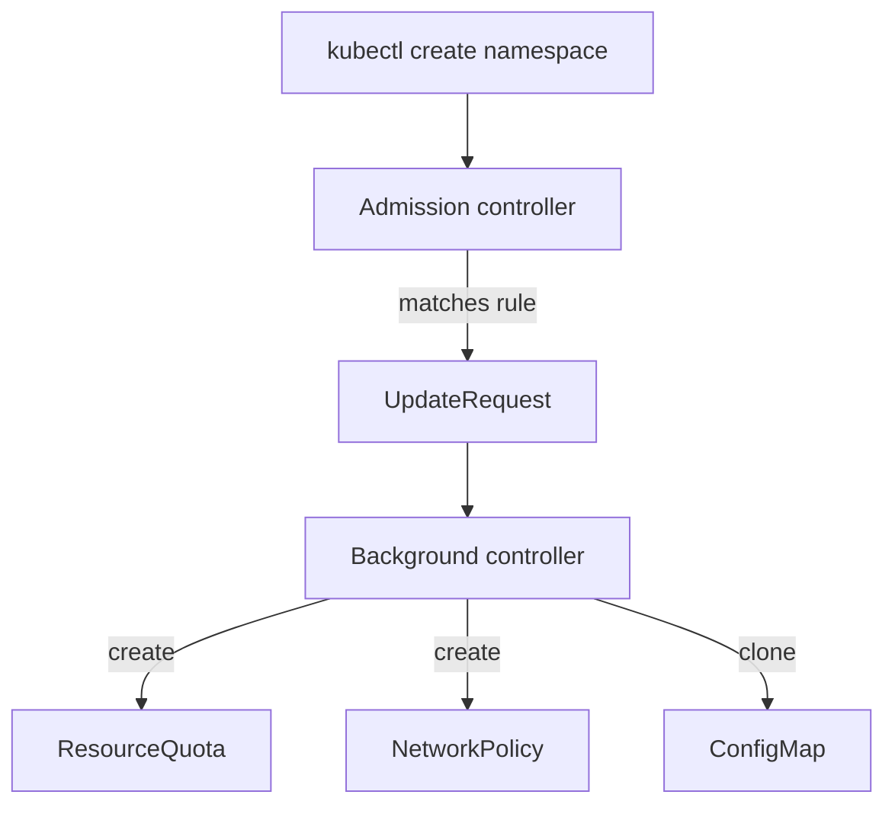

# Generate Rules, Synchronize And Clone

Every new namespace in a shared cluster needs the same starting objects: a quota that limits what the team can consume, a `NetworkPolicy` that denies traffic by default, and a banner ConfigMap. Creating them by hand is slow, and people forget. A `generate` rule makes Kyverno create these objects the moment the namespace appears. This part writes that rule, shows the two ways to describe the new objects, and explains what the `synchronize` field does when someone changes or deletes them.

## What happens when a namespace is created

A generate rule does not change the request. The admission controller sees the new namespace, finds a matching generate rule and records the work in an object called an `UpdateRequest` (a Kyverno resource in the `kyverno` namespace). The **background controller** (the Deployment `kyverno-background-controller`) reads the `UpdateRequest` and creates the new resources, using its own service account.



The diagram shows that the background controller, not the user, creates the resources. A user who may create namespaces does not need any right on quotas. Kyverno itself needs it, and that is the first thing to check.

## Check what the background controller may create

Kyverno 1.13 ships a default role for the background controller, and a generate rule fails if that role does not cover the target kind. Do not guess. Ask the API server what the service account can do:

```sh
kubectl auth can-i create networkpolicies --as=system:serviceaccount:kyverno:kyverno-background-controller
kubectl auth can-i create resourcequotas --as=system:serviceaccount:kyverno:kyverno-background-controller
kubectl auth can-i create configmaps --as=system:serviceaccount:kyverno:kyverno-background-controller
```

<!-- astrona:playground:renew -->

Each command prints `yes` or `no`. When an answer is `no`, add a ClusterRole that carries the label `rbac.kyverno.io/aggregate-to-background-controller: "true"`. Kyverno's own ClusterRole collects every role with that label, as Kubernetes aggregated roles do. Save this as `clusterrole-background-extra.yaml`:

```yaml
apiVersion: rbac.authorization.k8s.io/v1
kind: ClusterRole
metadata:
  name: kyverno-background-extra
  labels:
    rbac.kyverno.io/aggregate-to-background-controller: "true"
rules:
  - apiGroups: ["networking.k8s.io"]
    resources: ["networkpolicies"]
    verbs: ["get", "list", "watch", "create", "update", "delete"]
  - apiGroups: [""]
    resources: ["resourcequotas", "configmaps"]
    verbs: ["get", "list", "watch", "create", "update", "delete"]
```

Apply it, wait a few seconds for the aggregation, and run the three `can-i` commands again. They all print `yes` now. Applying the role when the defaults already allow the actions does no harm.

## Writing the generate rule

A generate rule has a `match` block for the trigger and a `generate` block for the new resource. The block names the `apiVersion`, `kind`, `name` and `namespace` of the downstream resource, and the content comes from either `data` or `clone`. The expression `{{request.object.metadata.name}}` is a variable: Kyverno replaces it with the name of the trigger, so the new objects land in the new namespace.

Save this as `policy-new-namespace.yaml`:

```yaml
apiVersion: kyverno.io/v1
kind: ClusterPolicy
metadata:
  name: new-namespace-resources
spec:
  rules:
    - name: quota
      match:
        any:
          - resources:
              kinds:
                - Namespace
              selector:
                matchLabels:
                  bootstrap: "true"
      generate:
        apiVersion: v1
        kind: ResourceQuota
        name: standard-quota
        namespace: "{{request.object.metadata.name}}"
        synchronize: true
        data:
          spec:
            hard:
              pods: "20"
    - name: deny-ingress
      match:
        any:
          - resources:
              kinds:
                - Namespace
              selector:
                matchLabels:
                  bootstrap: "true"
      generate:
        apiVersion: networking.k8s.io/v1
        kind: NetworkPolicy
        name: deny-all-ingress
        namespace: "{{request.object.metadata.name}}"
        synchronize: true
        data:
          spec:
            podSelector: {}
            policyTypes:
              - Ingress
    - name: banner
      match:
        any:
          - resources:
              kinds:
                - Namespace
              selector:
                matchLabels:
                  bootstrap: "true"
      generate:
        apiVersion: v1
        kind: ConfigMap
        name: fleet-banner
        namespace: "{{request.object.metadata.name}}"
        synchronize: false
        clone:
          namespace: fleet-system
          name: fleet-banner
```

The rules match only namespaces with the label `bootstrap: "true"`. The first two use `data`: the content is written inside the policy. The third uses `clone`: Kyverno copies an existing object, here `fleet-banner` from `fleet-system`. Use `data` when every namespace gets the same fixed content, and `clone` when the content lives in one source object that people edit.

Apply the policy, wait until it is ready, then create a namespace with the label and list what Kyverno generated:

```sh
kubectl apply -f policy-new-namespace.yaml
kubectl get clusterpolicy new-namespace-resources
kubectl create namespace crew-a
kubectl label namespace crew-a bootstrap=true
```

Nothing is generated for `crew-a`. The label was added after the namespace was created, and the trigger is the `CREATE` request, which had no label. Create a second namespace with the label in its YAML. Save this as `namespace-crew-b.yaml`:

```yaml
apiVersion: v1
kind: Namespace
metadata:
  name: crew-b
  labels:
    bootstrap: "true"
```

```sh
kubectl apply -f namespace-crew-b.yaml
kubectl get resourcequota,networkpolicy,configmap -n crew-b
```

The list shows `standard-quota`, `deny-all-ingress` and `fleet-banner`, usually within a few seconds. Kyverno labels each generated object, for example `app.kubernetes.io/managed-by: kyverno`. If nothing appears, run `kubectl get updaterequests -n kyverno` and `kubectl describe` the entry. A permission error there points back to the ClusterRole above.

## What synchronize does

The `synchronize` field decides how long Kyverno keeps control of the generated object. With `synchronize: true`, Kyverno keeps the downstream object equal to the rule. With `synchronize: false`, Kyverno creates the object once and then leaves it alone.

| Event | `synchronize: true` | `synchronize: false` |
| --- | --- | --- |
| Someone edits the generated object | Kyverno restores the content from the rule | The edit stays |
| Someone deletes the generated object | Kyverno creates it again | It stays deleted |
| The policy or rule is deleted | Kyverno deletes the generated objects | The objects stay |
| The clone source changes (`clone`) | Kyverno copies the new content to every clone | Clones keep the old content |

Test the table. Delete the generated `NetworkPolicy` and edit the quota, and watch Kyverno undo both; then edit the cloned ConfigMap and see that the edit stays. Save this as `configmap-banner-patch.yaml`:

```yaml
data:
  message: edited by hand
```

```sh
kubectl delete networkpolicy deny-all-ingress -n crew-b
kubectl patch resourcequota standard-quota -n crew-b --type merge -p '{"spec":{"hard":{"pods":"99"}}}'
kubectl patch configmap fleet-banner -n crew-b --patch-file configmap-banner-patch.yaml
```

After a short wait, `kubectl get networkpolicy -n crew-b` shows the policy again, and `kubectl get resourcequota standard-quota -n crew-b -o jsonpath='{.spec.hard.pods}'` prints `20`, the value from the rule. `kubectl get configmap fleet-banner -n crew-b -o jsonpath='{.data.message}'` still prints `edited by hand`, because the banner rule uses `synchronize: false`.

Use `true` for objects that enforce a control, such as a default-deny `NetworkPolicy` or a quota, because nobody should weaken them by editing. Use `false` when the generated object is a starting point that a team may customize.

## Existing namespaces and a summary of the part

A generate rule reacts to the admission of its trigger. Namespaces that existed before the policy produce no event, so they get nothing. Kyverno has a policy field named `generateExisting` that backfills existing triggers, but it is off by default, and the rule above does not use it. Namespaces that exist before the policy, such as `crew-a`, stay empty.

You can now write a generate rule with `data` and `clone`, check the permissions behind it, and predict what edits and deletes do under each `synchronize` value. The next kind of policy runs on a clock instead of on a request.

## Common pitfalls

> [!WARNING]
> - Labelling a namespace after creation and expecting a generate rule to fire. The rule reacts to the `CREATE` request, so put the label in the namespace YAML.
> - Forgetting RBAC. The rule is accepted and the `UpdateRequest` fails, so check `kubectl auth can-i ... --as=system:serviceaccount:kyverno:kyverno-background-controller`.
> - Using `synchronize: true` on an object that teams must customize. Their edits are reverted.
> - Deleting a policy that has `synchronize: true` rules and being surprised that the generated objects disappear.
> - Cloning from a source object that does not exist. The clone fails, and the `UpdateRequest` shows why.
