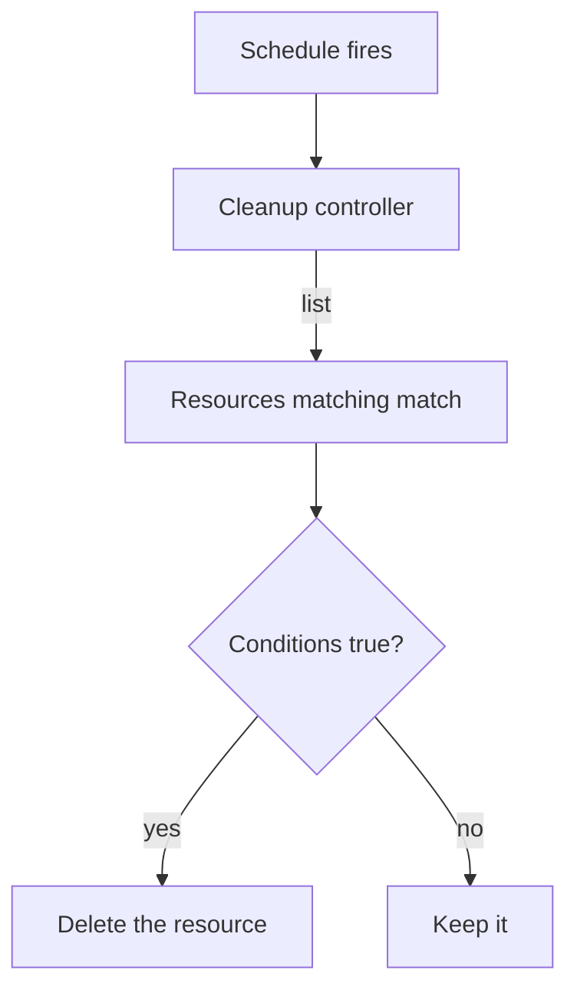

# Cleanup Policies And The Cleanup Controller

Clusters collect clutter: test ConfigMaps that nobody removed, completed jobs, old preview deployments. Deleting them by hand never happens on time. A Kyverno cleanup policy deletes resources automatically, on a schedule, when they match a selection and a set of conditions. This part writes one cleanup policy, shows how the controller that runs it gets permission to delete, and proves that it only removes the objects it should.

## Two kinds of cleanup policy

A cleanup policy is a Kyverno resource of its own. It is not a `ClusterPolicy` with a `delete` rule. There are two kinds, and they differ only in scope. A `ClusterCleanupPolicy` can match resources in any namespace. A `CleanupPolicy` lives in one namespace and can only delete resources in that namespace. The spec has three parts that you write for every policy. A resource is deleted only when it matches the `match` block and the conditions are true at the time the schedule runs.

- `match` (and an optional `exclude`) selects the resources, with the same `kinds`, `namespaces` and `selector` fields as in other policies.
- `conditions` filters the selection further. In a cleanup policy the resource under test is available as the variable `target`, for example `{{ target.metadata.labels.expired }}`.
- `schedule` is a cron expression in the standard five-field format. `"* * * * *"` means every minute and `"0 3 * * *"` means every day at 03:00.



The diagram shows that the cleanup controller does the deleting, one resource at a time, and that conditions are checked for each resource.

The kind of cleanup you can express with conditions is wide. A condition can compare a label, an annotation, a field of the object, or the age of the object using JMESPath time functions. This part uses a label so that every step is easy to read and check. Kyverno also supports a time-to-live label that tells the cleanup controller to remove a resource after a given time, without any policy; the policy approach is more general because you choose the conditions.

## Write a cleanup policy

The playground has the namespace `scratch` with two ConfigMaps. `old-report` carries `expired: "true"` and `keep-report` carries `expired: "false"`. Save this as `cleanup-expired-reports.yaml`:

```yaml
apiVersion: kyverno.io/v2
kind: ClusterCleanupPolicy
metadata:
  name: remove-expired-reports
spec:
  match:
    any:
      - resources:
          kinds:
            - ConfigMap
          namespaces:
            - scratch
  conditions:
    any:
      - key: "{{ target.metadata.labels.expired || 'false' }}"
        operator: Equals
        value: "true"
  schedule: "* * * * *"
```

The `match` block selects every ConfigMap in `scratch`, including the one that Kubernetes creates in every namespace, `kube-root-ca.crt`. The condition then keeps only the objects labelled `expired: "true"`. The `|| 'false'` part gives a default for objects without the label, so the condition always has a value to compare.

If your cluster answers `no matches for kind "ClusterCleanupPolicy" in version "kyverno.io/v2"`, list the versions that the installed CRD serves, and use one of them in `apiVersion`:

```sh
kubectl get crd clustercleanuppolicies.kyverno.io -o jsonpath='{.spec.versions[*].name}{"\n"}'
```

<!-- astrona:playground:renew -->

Do not apply the policy yet. A cleanup policy is only useful when the controller may delete the kind it matches, and the next section checks that first.

## Give the cleanup controller permission to delete

The **cleanup controller** is the Kyverno Deployment `kyverno-cleanup-controller`. It runs cleanup policies with its own service account, so what it may delete depends on its ClusterRole, not on your rights. Ask the API server:

```sh
kubectl auth can-i delete configmaps --as=system:serviceaccount:kyverno:kyverno-cleanup-controller
```

When the answer is `no`, the policy would be accepted and never delete anything. Add a ClusterRole with the label `rbac.kyverno.io/aggregate-to-cleanup-controller: "true"`, which Kyverno's cleanup role aggregates. Save this as `clusterrole-cleanup-configmaps.yaml`:

```yaml
apiVersion: rbac.authorization.k8s.io/v1
kind: ClusterRole
metadata:
  name: kyverno-cleanup-configmaps
  labels:
    rbac.kyverno.io/aggregate-to-cleanup-controller: "true"
rules:
  - apiGroups: [""]
    resources: ["configmaps"]
    verbs: ["get", "list", "watch", "delete"]
```

Apply the role, then apply the policy:

```sh
kubectl apply -f clusterrole-cleanup-configmaps.yaml
kubectl apply -f cleanup-expired-reports.yaml
kubectl get clustercleanuppolicy remove-expired-reports
```

The cleanup controller also runs a webhook that validates cleanup policies, so wait until the policy is accepted. After the schedule fires, which takes up to about a minute, list the ConfigMaps:

```sh
kubectl get configmap -n scratch
```

`old-report` is gone. `keep-report` and `kube-root-ca.crt` remain. `kubectl describe clustercleanuppolicy remove-expired-reports` shows the policy status and events, including when the policy last ran.

## Prove that conditions protect the rest

A cleanup policy is destructive, so test it on objects you can afford to lose. Create two new ConfigMaps in `scratch`, one for each side of the condition:

```sh
kubectl create configmap temp-a -n scratch --from-literal=k=v
kubectl label configmap temp-a -n scratch expired=true
kubectl create configmap temp-b -n scratch --from-literal=k=v
```

After the next minute, `temp-a` is deleted and `temp-b` remains, because `temp-b` has no `expired` label and so the condition is false for it. This is the safety of `conditions`: the `match` block selects candidates, and the condition decides for each one. A wrong condition is dangerous, because the policy deletes at every run without asking. If you changed the condition to `value: "false"`, it would delete `keep-report` and `temp-b` and every other ConfigMap without the label. Narrow `match` as far as you can with `kinds`, `namespaces` and `selector`, and use `conditions` for the final decision.

For safe use, add `exclude` blocks for namespaces that must never be touched, keep schedules as slow as the need requires, and read `kubectl get events -n kyverno` after a new policy's first run.

You can now write a cleanup policy and the RBAC that lets the cleanup controller act on it. Cleanup removes objects that exist. The last policy type of this module decides whether an object may start at all.

## Common pitfalls

> [!WARNING]
> - Applying a cleanup policy without checking `kubectl auth can-i delete <resource> --as=system:serviceaccount:kyverno:kyverno-cleanup-controller`. The policy is accepted and does nothing.
> - Matching broadly and relying only on conditions. One typo in a condition can delete objects you wanted to keep.
> - Using a `CleanupPolicy` and expecting it to delete in other namespaces. It works only in its own namespace.
> - Forgetting the `|| 'default'` fallback in a condition on an optional label or annotation.
> - Testing on real data. Test with objects created for the test, and delete the policy afterwards.
