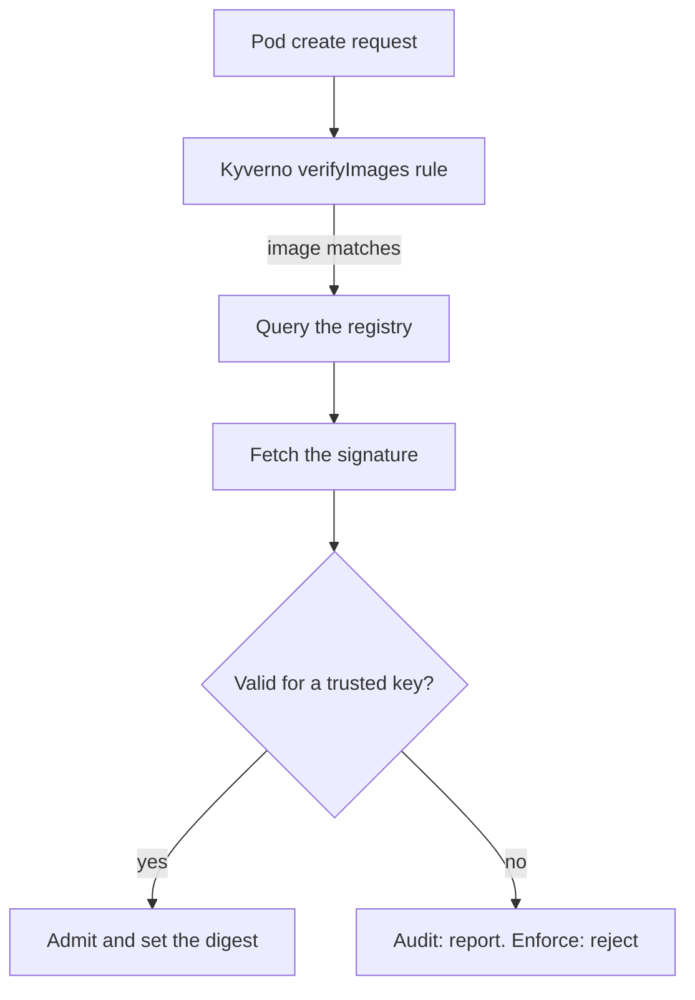

# Image Verification Overview

The other policy types check what a manifest says. They cannot tell you whether the container image that the manifest names is the image your team built. A registry tag such as `app:1.4` can be pushed again with different content, and an attacker who gains write access to a registry can swap an image without changing any manifest. Image verification closes that gap: Kyverno checks a cryptographic signature on the image before a pod can use it. This part is reading only. It explains the rule so that you can read one in a policy and answer exam questions about it, and it explains why this course gives you no lab for it.

## What an image signature is

A **signature** is a small piece of data that proves a specific party approved a specific image. The signing tool, most often `cosign`, computes the image **digest** (a SHA-256 hash of the image manifest, written `sha256:...`), signs the digest with a private key, and stores the signature as an extra object in the same registry, next to the image. Anyone with the matching public key can check that the digest was signed by the key holder. If someone changes the image, the digest changes and the old signature no longer matches.

A tag is only a movable label for a digest. This is why image verification works on digests and why Kyverno can replace a tag with its digest in the pod, so that the pod runs exactly the image that was checked.

## The verifyImages rule

A `verifyImages` rule is a fourth rule type next to `validate`, `mutate` and `generate`. It matches pods, lists the images it applies to, and describes who must have signed them. This example is for reading only. Do not apply it: the key and the registry are placeholders.

```yaml
apiVersion: kyverno.io/v1
kind: ClusterPolicy
metadata:
  name: verify-signed-images
spec:
  validationFailureAction: Audit
  webhookTimeoutSeconds: 30
  rules:
    - name: check-signature
      match:
        any:
          - resources:
              kinds:
                - Pod
      verifyImages:
        - imageReferences:
            - "registry.example.com/fleet/*"
          mutateDigest: true
          verifyDigest: true
          required: true
          attestors:
            - entries:
                - keys:
                    publicKeys: |-
                      -----BEGIN PUBLIC KEY-----
                      (public key goes here)
                      -----END PUBLIC KEY-----
```

The field `imageReferences` is a list of image patterns with wildcards. Images that do not match are not checked at all, so a pod using another registry passes unless another rule stops it. The `attestors` block says who counts as a trusted signer. An **attestor** is a signer that Kyverno trusts, and an entry is either a static public key or a keyless identity. A keyless entry names a certificate issuer and a subject from a certificate authority such as Sigstore, so no long-lived private key exists. The field `required: true` means that an image without a valid signature fails the rule. The field `verifyDigest: true` demands that the image reference has a digest after the checks, and `mutateDigest: true` makes Kyverno rewrite the tag in the pod to the digest it verified.



The diagram shows that Kyverno must reach the registry during admission, because it fetches the signature from there.

## Audit and Enforce

Image verification uses the same action field as validate rules. With `validationFailureAction: Enforce`, a pod with an unsigned or wrongly signed image is rejected. With `Audit`, the pod is admitted and the failure appears in a policy report. Start every rollout in `Audit`: it shows which running workloads use unsigned images, and you can fix the build pipelines before you block anything. The timeout matters more here than in other policies, because each admission request makes network calls to the registry. A slow registry slows pod creation, and `webhookTimeoutSeconds` bounds the wait. A rule can also pin which images apply with `imageReferences` and use `failurePolicy` to decide whether an unreachable Kyverno blocks pods or lets them through.

## Why this course has no lab for it

A lab needs a signed image, and a signed image needs three things that a throwaway sandbox cluster does not have. It needs a registry that stores the image and the signature. It needs a signing key pair, and a secure place to keep the private key. And it needs the signing tool to run against the registry before the cluster starts, so the check has something to find. A kind cluster starts empty and offline from your build pipeline, and a lab that downloads a signed image from the internet would depend on a third party's key and registry. Such a lab would also be very slow to grade, because every pod creation waits on registry calls.

So the lesson is the concept. You should be able to read a `verifyImages` rule and say which images it checks, who may sign them, what `Audit` and `Enforce` do, what the digest fields do, and why a registry and a signing key are required.

## Common pitfalls

> [!WARNING]
> - Starting in `Enforce`. An unsigned image anywhere in the cluster then blocks its pods. Start in `Audit`.
> - Writing `imageReferences` that match too much, so that system images without signatures fail.
> - Trusting a tag. A tag can point to different content tomorrow; the digest cannot.
> - Forgetting that Kyverno needs network access to the registry. A private registry also needs pull credentials for Kyverno.
> - Treating `verifyImages` as a replacement for vulnerability scanning. A signature says who approved the image, not that the image is free of faults.

## Your mission: Apply Generate And Cleanup Policies

You can now write a generate rule, give the background controller the rights it needs, schedule a cleanup policy, and read a `verifyImages` rule. The mission gives you a cluster with namespaces that need defaults and ConfigMaps that expire: you write the RBAC, one generate policy with three rules, and one cleanup policy. The task is on the next page.

Pause the playground, start the lab, and submit when you think the policies work:

```sh
astrona stop ats-010-playground-040-02
astrona run --git git@github.com:astrona-io/ATS010.git -c sections/section-040/module-02/labs/lab-01
astrona submit --git git@github.com:astrona-io/ATS010.git -c sections/section-040/module-02/labs/lab-01
```

When you are done, remove the lab and start the playground again:

```sh
astrona destroy ats-010-lab-011
astrona start ats-010-playground-040-02
```
