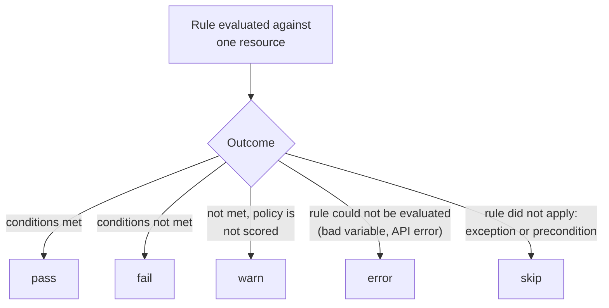

# Part 1 — Anatomy of a Report

## A report is a list of verdicts about resources

When Kyverno evaluates a resource against a `validate` rule, it records a verdict. The verdicts are stored in a report object next to the resource. There are two kinds of report, and the only thing that decides which one you get is the scope of the resource that was checked:

| Resource that was checked | Report kind | Scope of the report |
| --- | --- | --- |
| A namespaced resource (Pod, Deployment, ConfigMap, ...) | `PolicyReport` | Lives in the same namespace as the resource |
| A cluster-scoped resource (Namespace, Node, ClusterRole, ...) | `ClusterPolicyReport` | Lives at cluster level, no namespace |

Notice that the kind of the *policy* does not matter here. A `ClusterPolicy` that matches ConfigMaps writes `PolicyReport` objects in the ConfigMaps' namespaces. A namespaced `Policy` can only ever see resources in its own namespace, so it also writes `PolicyReport` objects.

> [!NOTE]
> Both kinds are defined by the `wgpolicyk8s.io` API group (a Kubernetes Policy Working Group schema), served at `v1alpha2` by Kyverno 1.13. Short names exist: `polr` for `policyreport` and `cpolr` for `clusterpolicyreport`. Check with `kubectl api-resources --api-group=wgpolicyk8s.io` if your installation differs.

## The shape of a report

This is the *shape* of a report, written out so that you know where to look. Names, counts and timestamps in your cluster will differ, and Kyverno may add extra labels and annotations.

```yaml
apiVersion: wgpolicyk8s.io/v1alpha2
kind: PolicyReport
metadata:
  name: <usually derived from the resource's UID>
  namespace: fleet-reports
scope:                       # what this report is about (present in 1.13)
  apiVersion: v1
  kind: ConfigMap
  name: legacy-delta
  namespace: fleet-reports
summary:                     # counters over results[] of THIS report
  pass: 0
  fail: 1
  warn: 0
  error: 0
  skip: 0
results:
  - policy: require-owner-label
    rule: check-owner-label
    result: fail
    message: "validation error: ConfigMaps labelled app=fleet must carry an owner label. ..."
    scored: true
    source: kyverno
    timestamp: { seconds: ..., nanos: ... }
```

Two blocks matter: `summary` is the tally, `results` is the evidence. Read `summary` to know whether you have a problem, and read `results` to learn what the problem is.

## The result fields

| Field | What it holds |
| --- | --- |
| `policy` | Name of the policy that produced the verdict. For a namespaced `Policy`, Kyverno may prefix the namespace; do not assume a bare name in a script that must also cover `Policy` objects. |
| `rule` | Name of the rule inside that policy. One policy with three rules can write three results for one resource. |
| `result` | One of `pass`, `fail`, `warn`, `error`, `skip`. See below. |
| `message` | Human-readable reason. For a `fail` it contains the validate message you wrote in the policy. |
| `scored` | `true` if the result counts toward the score of the report. Policies can opt out with the `policies.kyverno.io/scored` annotation set to `"false"`. |
| `severity` | Optional, taken from the policy's `policies.kyverno.io/severity` annotation (for example `low`, `medium`, `high`). |
| `category` | Optional, taken from the `policies.kyverno.io/category` annotation. |
| `source` | Who wrote the result. For Kyverno it is `kyverno`. |
| `scope` / `resources` | The resource the verdict is about. In Kyverno 1.13 the report generally carries a top-level `scope`; the older `resources` list inside each result may also be present or absent. |

> [!WARNING]
> **Common pitfall**
>
> Writing a script that reads only `results[].resources[0].name`. Whether a result carries a `resources` list, or the report carries a top-level `scope`, depends on the Kyverno version. A robust query reads `scope.name` first and falls back to `resources[0].name`. The labs in this section do exactly that.

## The five result values



- `pass` means the resource satisfied the rule.
- `fail` means the resource violated the rule. Under `Audit` the resource was still admitted. Under `Enforce` the request that would create the resource is rejected, so a `fail` for a newly created resource mostly appears for resources that already existed (background scan) or for `Audit` rules.
- `warn` is a failure that does not count as a hard failure. As far as this course is concerned, the usual source is a policy annotated `policies.kyverno.io/scored: "false"`, whose failures are recorded as `warn`. Do not expect `warn` from a plain `Audit` policy.
- `error` means Kyverno could not evaluate the rule at all, for example because a context lookup failed. An `error` is not a violation, and it is not a pass either; treat it as "unknown, investigate".
- `skip` means the rule did not apply to the resource. A common cause is a `PolicyException` that matches the resource; another is a rule whose preconditions are not true. A resource that is simply not selected by `match` or is excluded usually produces no result at all, not a `skip`.

> [!TIP]
> **Try it — read one failing result completely**
>
> In the playground, pick the failing ConfigMap and print its report:
> ```sh
> kubectl -n fleet-reports get policyreport
> kubectl -n fleet-reports get policyreport -o yaml | less
> ```
> Find the `result: fail` entry. Read its `policy`, `rule` and `message`. Then find the `summary` of the same report and confirm that `fail` is counted there.

## The summary counters

`summary` has one counter per result value, and each counter counts the entries of `results[]` of that single report. Two consequences follow:

- The counters never describe the whole cluster. To total them, add up the reports yourself (the next part shows how).
- They count *results*, not *resources*. A resource that fails two different rules counts as two fails.

## Namespaced and cluster-scoped, side by side

Your playground has a policy for ConfigMaps (namespaced resources) and a policy for Namespaces (cluster-scoped resources). The same `kubectl get` on the two report kinds tells the story:

```sh
kubectl get policyreport -A
kubectl get clusterpolicyreport
```

The first command lists reports in many namespaces and needs `-A` or `-n`. The second needs neither, because cluster-scoped objects have no namespace. A common mistake is to look for the verdict on a Namespace in `kubectl get policyreport`; it is never there.

## One report per namespace, or one per resource?

Older Kyverno releases aggregated results into one report per namespace, with names like `polr-ns-<namespace>`. Newer releases, including 1.13 as far as this course is concerned, create reports generally per resource, with the report named after the resource's UID and owned by that resource, so a deleted resource takes its report with it. Because the exact layout is a version detail, this course never depends on it: every query in the labs works if a report holds one resource or fifty. Check your own cluster with `kubectl get policyreport -n <ns> -o name` and read `scope` in one of them.
