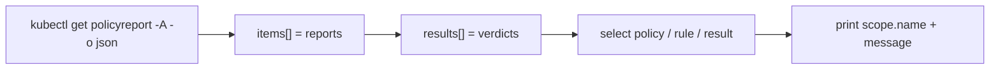

# Part 2 — Querying Reports with kubectl and jq

## From many small reports to one answer

If reports are generally one per resource, `kubectl get policyreport -A` can print hundreds of rows. The `kubectl` table shows the counters, which is enough to find a report with a problem, but not enough to say which rule, which resource and why. The way out is to ask for JSON and let `jq` flatten the structure.



## The quick views

```sh
kubectl get policyreport -A                  # one row per report with counters
kubectl get policyreport -n fleet-reports    # one namespace
kubectl get clusterpolicyreport              # cluster-scoped resources
kubectl get polr,cpolr -A                    # both kinds, short names
kubectl describe policyreport -n fleet-reports <name>
```

The default columns are the counters (`PASS`, `FAIL`, `WARN`, `ERROR`, `SKIP`) and the age; on some versions also the scope of the report. If a counter column is missing in your version, fall back to `-o json`.

## jsonpath: simple and limited

`-o jsonpath` can print a field without any other tool. It has no real filtering, so it is good for one report at a time:

```sh
kubectl -n fleet-reports get policyreport <name> -o jsonpath='{.summary}'
kubectl -n fleet-reports get policyreport -o jsonpath='{range .items[*]}{.scope.name}{"\t"}{.summary.fail}{"\n"}{end}'
```

The second command prints the scoped resource name and its fail count, one line per report. If `scope` is absent in your version, you get empty names; that is your signal to use `resources[0].name` from the results instead.

## jq: the tool for real questions

All of these assume `jq` is installed on your machine. The pattern is always: take `items[]`, keep the report in a variable, then walk `results[]`.

List every failing result across all namespaces, with the namespace of the report, the resource, the policy and the rule:

```sh
kubectl get policyreport -A -o json | jq -r '
  .items[] as $r
  | $r.results[]?
  | select(.result == "fail")
  | [$r.metadata.namespace, ($r.scope.name // .resources[0].name // "?"), .policy, .rule]
  | @tsv'
```

The `?` after `results[]` stops `jq` from raising an error on a report without results. The `//` operator picks the first non-null value, which is how the version-tolerant resource name works.

Count results per value for one policy:

```sh
kubectl get policyreport -A -o json | jq -r --arg p require-owner-label '
  [.items[].results[]? | select(.policy == $p) | .result]
  | group_by(.) | map({result: .[0], count: length})'
```

Total the counters of all reports in a namespace, which is the namespace-wide equivalent of a single `summary`:

```sh
kubectl -n fleet-reports get policyreport -o json | jq '
  [.items[].summary] | {pass: (map(.pass // 0) | add), fail: (map(.fail // 0) | add)}'
```

Print only the failing message for one rule:

```sh
kubectl get policyreport -A -o json | jq -r '
  .items[].results[]? | select(.rule == "check-owner-label" and .result == "fail") | .message'
```

The same patterns work for cluster-scoped resources; just drop the namespace and read from `clusterpolicyreport`:

```sh
kubectl get clusterpolicyreport -o json | jq -r '
  .items[] as $r | $r.results[]? | select(.result == "fail")
  | [($r.scope.name // .resources[0].name // "?"), .policy, .rule] | @tsv'
```

> [!TIP]
> **Try it — build the shopping list of violators**
>
> In the playground, write one `jq` command that prints the names of all failing ConfigMaps, sorted and without duplicates, and one that prints the names of failing Namespaces. Then compare your answer with the table of seeded resources in `docs/overview.md`. If a name is missing, check whether you filtered on `policy` correctly.

## Labels and field selectors: filtering before jq

Reports are Kubernetes objects, so ordinary selectors apply. Kyverno labels its reports, so you can often select by label instead of downloading everything, but the label keys are a version detail. Print the labels once (`kubectl -n fleet-reports get policyreport --show-labels`) and then decide. A safe approach for a script is to download the namespace and filter with `jq`; it is slower but never depends on a label name.

## Reading a result as a diagnosis

A `fail` result is a diagnostic in three parts:

1. `rule` tells you which part of the policy complained. Open the policy and find that rule.
2. `message` tells you what was expected. It is the `validate.message` you wrote, usually followed by the path of the offending field.
3. `scope` (or `resources`) tells you which object to go and fix.

Fixing the resource, not the report, is the only way to turn a `fail` into a `pass`. Reports are written by Kyverno and are overwritten; editing one by hand achieves nothing.

> [!WARNING]
> **Common pitfall**
>
> Concluding "zero violations" from an empty `kubectl get policyreport -A`, right after you applied a policy. Reports are generated asynchronously. An empty list shortly after a change can mean "nothing found yet". Poll for a few minutes before you conclude, or confirm that the policy is `Ready` first with `kubectl get clusterpolicy`. The next module explains where the delay comes from.

## Reference

- `kubectl api-resources --api-group=wgpolicyk8s.io` — report kinds and short names.
- `kubectl get polr,cpolr -A` — everything at a glance.
- `kubectl explain policyreport.results` — the schema, including fields not covered here.
- `-o json | jq` with `.items[] as $r | $r.results[]?` — the pattern for every question about results.
