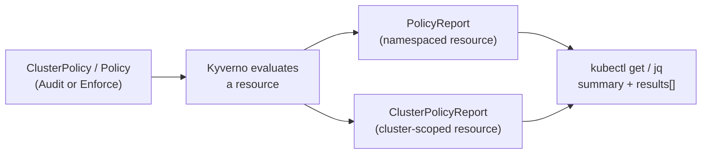

# Reading PolicyReport and ClusterPolicyReport

A policy that runs is only useful if you can tell what it found. Kyverno answers that question with reports: ordinary Kubernetes objects that list, for each resource, which policy rules passed, failed, warned, errored or were skipped. Reports are how an `Audit` policy "reports" a violation, how a background scan tells you about resources that existed before the policy, and how you decide whether a policy is safe to switch to `Enforce`. This module teaches you to read them accurately.

Both report kinds belong to the `wgpolicyk8s.io` API group, a policy-report format defined by the Kubernetes Policy Working Group, not by Kyverno alone. Kyverno 1.13 writes them with `apiVersion: wgpolicyk8s.io/v1alpha2`. The Kyverno CRDs for them are installed together with Kyverno itself, so you never create a report by hand.

## How this module is organised

1. **[Part 1 — Anatomy of a Report](./course-01-anatomy-of-a-report.md)** — `summary`, `results[]`, the five result values, and why namespaced and cluster-scoped resources land in different report kinds.
2. **[Part 2 — Querying Reports with kubectl and jq](./course-02-querying-reports.md)** — turning a pile of report objects into an answer: which resources fail which rule, how many, and why.
3. **[Summary](./course-03-summary.md)** — what to remember.

## Learning objectives

After this module you can:

- Explain what `PolicyReport` and `ClusterPolicyReport` are, which API group they belong to, and which one holds the result for a given resource.
- Name every field of a result that you need to read a finding: `policy`, `rule`, `result`, `message`, `scored`, `severity`, `scope` and `resources`.
- Explain what the `summary` counters mean and why they are per report, not per cluster.
- Hedge correctly on layout: say how reports are split in Kyverno 1.13 (generally one per resource) and why a query must not depend on that.
- List failing results with `kubectl` and `jq`, filtered by policy, rule, namespace or result value.

## Before you start

You should know what a `ClusterPolicy` is and how `Audit` differs from `Enforce` (Section 010). The playground gives you a kind cluster with Kyverno 1.13.2, two `Audit` policies and a small set of seeded ConfigMaps and Namespaces, some compliant and some not. `kubectl` points at it and `jq` is expected on your machine.

Launch your playground now, and keep it running next to you while you read the parts:

<!-- astrona:playground -->
