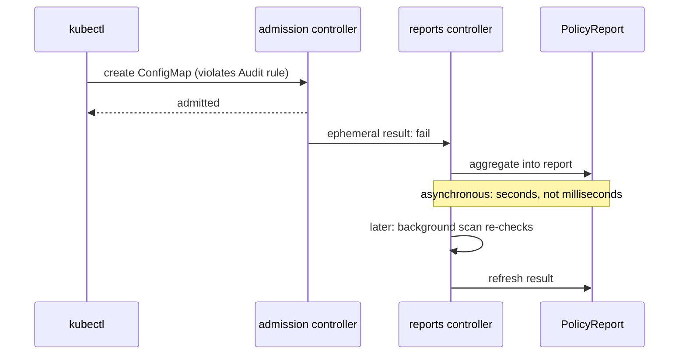

# Part 1 — Two Sources: Admission and Background Scan

## Source 1: the admission webhook

When a request creates or updates a resource that a policy matches, Kyverno's admission controller evaluates the rules while the request is in flight. What happens next depends on the policy action:

| Policy action | Resource fails the rule | Resource passes the rule |
| --- | --- | --- |
| `Audit` | Request is admitted, a `fail` result is recorded | Request is admitted, a `pass` result is recorded |
| `Enforce` | Request is rejected, the resource never exists | Request is admitted, a `pass` result is recorded |

The admission controller does not write the final report itself. It hands the result to the reports machinery as a small internal object, and the reports controller aggregates it later. That is why a result may appear a few seconds after the request, and not in the same instant as `kubectl apply` returns.

## Source 2: the background scan

Admission control has no memory of the past. Resources that existed before a policy was created, or that were last touched before the policy changed, are checked by the reports controller in a background scan. It runs:

- when a policy is created or changed, for the resources that policy matches,
- when a resource changes, for the policies that match it, and
- periodically, so that results do not go stale when something Kyverno could not see changes (for example, a policy reading data from a ConfigMap).

The periodic part is controlled by a flag on the reports controller. By default the background scan interval is one hour (`--backgroundScanInterval`, default `1h`). You can see the flags of your installation with:

```sh
kubectl -n kyverno get deploy kyverno-reports-controller -o jsonpath='{.spec.template.spec.containers[0].args}'
```

If the output does not list `backgroundScanInterval`, the default applies. Do not shorten the interval in production to "make reports faster"; the scan evaluates every matching resource each time.

> [!NOTE]
> A scan can only report. It never blocks, deletes or edits anything, whatever the policy's `validationFailureAction` says. A rule only takes part in the scan when `background: true`, which is the default for a policy and for each rule unless set otherwise.

## The reports you read are the aggregated product

Both sources write short-lived internal objects first. In Kyverno 1.13 these are `EphemeralReport` and `ClusterEphemeralReport` objects in the `reports.kyverno.io` API group. They exist to carry one evaluation each, and the reports controller merges them into the `PolicyReport` and `ClusterPolicyReport` objects, then removes them. You can list them if the CRDs are present in your version:

```sh
kubectl api-resources --api-group=reports.kyverno.io
kubectl get ephemeralreports -A
```

Treat them as plumbing. You never write a query against them, never edit them, and your tooling must not depend on their existence. The only reason to look is to understand a delay: if ephemeral reports pile up and do not shrink, the reports controller is behind or unhealthy, so check its logs with `kubectl -n kyverno logs deploy/kyverno-reports-controller`.



## Which controller does what

Kyverno 1.13 runs four controllers, each as its own Deployment in the `kyverno` namespace. Knowing their jobs tells you where to look when a result is missing.

| Controller | Job in the reporting pipeline |
| --- | --- |
| Admission controller | Answers webhook requests, evaluates rules in flight and sends each result to the reports machinery as an ephemeral report |
| Reports controller | Runs the background scan, merges ephemeral reports into `PolicyReport` and `ClusterPolicyReport` objects and removes the old ones |
| Background controller | Runs `generate` and `mutate-existing` rules. It does not write validation reports |
| Cleanup controller | Deletes resources for cleanup policies. It does not write validation reports |

A missing result for a validate rule is therefore a problem of the admission controller (the request never reached it) or of the reports controller (the result arrived and was not merged). The background and cleanup controllers are not part of that path.

The reports controller has switches for both sources. In 1.13 the flag `--admissionReports` enables the reports that admission creates from validate rules in `Audit` mode, and the flag `--backgroundScan` enables the background scan. Both default to `true`. If a cluster owner disabled one of them to save resources, one source of results is gone. Read the argument list of the reports controller before you conclude that a policy is wrong.

## The order of events for one change

Take a policy change as an example. You change the `match` of a policy that is `Ready`. Kyverno updates the policy object, and the reports controller sees the change. It queues a scan for every resource the new `match` selects. Results for resources that fell out of the match are removed. Results for new resources appear. All this happens after your `kubectl apply` returns, in seconds for a few resources and in minutes for thousands.

Now take a resource change. You label a ConfigMap. The admission controller sees the update request, evaluates the matching rules and sends results. The reports controller merges them into the report of that resource. The scan does not need to run, because admission already provided the new result. The periodic scan later confirms it. If admission was unavailable at the time of the update, the next scan picks the change up.

## What Enforce does and does not write

`Enforce` policies still produce reports, for two reasons that surprise newcomers:

1. A resource that passes an `Enforce` rule is admitted, and a `pass` result is recorded.
2. A resource that existed before the policy was switched to `Enforce`, and that violates it, is not rejected, because nothing is requested. The background scan finds it and records a `fail`.

What you will not find is a `fail` for a request that `Enforce` blocked. The resource was never created, so nothing exists to attach a report to. The rejection lives only in the API response to the client and in Kyverno's logs and metrics. Reports therefore describe the *existing* cluster, and are not a log of every rejected request.

> [!TIP]
> **Try it — see both sources in the playground**
>
> The `Audit` policy `require-owner-label` already produced results for the ConfigMaps seeded before you got the cluster (a scan result). Now create a new violating ConfigMap and watch its result appear:
> ```sh
> kubectl -n fleet-reports create configmap late-comer --from-literal=k=v
> kubectl -n fleet-reports label configmap late-comer app=fleet
> ```
> Note: `create` alone is not matched (no `app=fleet` label yet), but the label update is, and the ConfigMap has no `owner` label. Watch `kubectl -n fleet-reports get policyreport` over the next minute. Delete `late-comer` afterwards.

## Reference

- `kubectl -n kyverno get deploy kyverno-reports-controller -o yaml` — scan interval and worker flags.
- `kubectl api-resources --api-group=reports.kyverno.io` — whether ephemeral report CRDs are present.
- `kubectl -n kyverno logs deploy/kyverno-reports-controller` — when reports lag.
