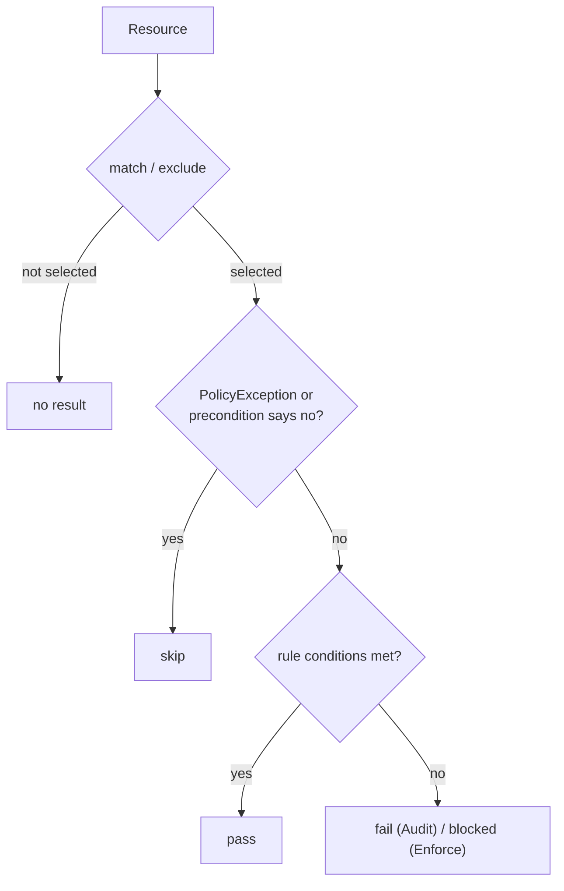

# Part 2 — Lifecycle: Deleted Resources, Deleted Policies and Skipped Results

## A result lives as long as both its resource and its policy

A result is a statement "this policy judged this resource". If either side disappears, the statement has no subject, and the reports controller removes it. Four situations cover almost everything:

| What you do | What happens to the result | How fast |
| --- | --- | --- |
| Fix the resource so it passes | `fail` is replaced by `pass` | Seconds to about a minute, on the update event |
| Delete the resource | The result disappears with it | Quickly in Kyverno 1.13, where a per-resource report is owned by the resource and garbage-collected; an aggregated layout needs the next aggregation |
| Delete the policy | Results of that policy are removed | Next aggregation, normally within a minute |
| Change the policy (rule, match) | Results are recomputed by a background scan | Right after the change, for the resources that policy matches |

> [!WARNING]
> **Common pitfall**
>
> Treating a stale `fail` as proof that the fix did not work. Fixing a resource changes the resource at once, but the report follows through the pipeline in the last part. Wait, then re-read. If the `fail` is still there after several minutes, then the fix is wrong, or the resource is not the one the report names.

## Why this matters for cleanup

Because the report follows the resource, deleting an unwanted violator is a legitimate remediation. A forgotten ConfigMap that nobody owns is, for the report, solved by `kubectl delete`. The opposite is also true: a report that still lists a resource means the resource still exists. When you cannot find it, search with the name and namespace from `scope`, and check that you are looking in the right cluster.

## What one result holds

A report result is a small object. It names the `policy` and the `rule`, and it has a `result` value: `pass`, `fail`, `warn`, `error` or `skip`. It has a `message` that Kyverno fills for failures, a `source` field (for Kyverno it is `kyverno`), a `scored` flag, a timestamp, and the resource that it judged. A `scored: false` result comes from a policy that carries the annotation `policies.kyverno.io/scored: "false"`. Such a policy reports failures as `warn`. The report also has a `summary` with one counter for each result value.

The pair of policy and rule, together with the resource, is the identity of a result. A new evaluation of the same pair replaces the old result and does not add a second one. That is why a report does not grow each time a scan runs. It also explains why the `fail` count drops without any change in the report object count when you fix a resource.

An `error` result is not a violation. It means that Kyverno could not evaluate the rule, for example because a variable has no value or an API call in a `context` entry failed. Treat an `error` as a defect in the policy or in the environment. Do not count it as a clean result.

## Skipped results

A `skip` means that Kyverno looked at the resource and decided the rule did not apply. The usual causes are:

- A matching `PolicyException`. The rule is skipped for the excepted resource, and the report records a `skip` with a message that mentions the exception. Exceptions are disabled by default. The flag `--enablePolicyException=true` turns them on, and `--exceptionNamespace=<ns>` restricts the namespace where an exception may live. In Kyverno 1.13 both flags apply to the admission controller, the background controller and the reports controller. The cleanup controller does not use them. When you install with Helm, the chart value `features.policyExceptions.enabled` sets the flag on those controllers. When you install from the `install.yaml` manifest, as the labs do, you add the flag to the container arguments of each controller yourself. An exception also affects background results only when its `spec.background` is `true` or not set, which is the default. In that case a report result can change from `fail` to `skip`. Check your installation with `kubectl -n kyverno get deploy -o yaml | grep -n -i exception`.
- A rule whose `preconditions` evaluate to false for that resource.

A resource that is not selected by `match`, or that is hit by `exclude`, usually produces no result at all, rather than a `skip`. If you expect a `skip` and see nothing, the resource probably never reached the rule. Read the exact outcome from your own cluster before documenting it for your team.

A `PolicyException` that is valid in 1.13 uses the API version `kyverno.io/v2`. It names the policy and the rules to skip, and a `match` block that selects the resources:

```yaml
apiVersion: kyverno.io/v2
kind: PolicyException
metadata:
  name: allow-scratch
  namespace: fleet-reports
spec:
  exceptions:
    - policyName: require-owner-label
      ruleNames:
        - check-owner
  match:
    any:
      - resources:
          kinds:
            - ConfigMap
          names:
            - scratch
```

Both the admission path and the scan read the exception. Admission then admits the resource without a failure. The scan records `skip` for it, and a `fail` that existed before the exception turns into `skip` after the next scan. If the exception sits in a namespace that `--exceptionNamespace` does not allow, Kyverno ignores it and the `fail` stays.



`skip` is good news for a rollout gate. It means the exemption is visible, in the open, and countable. You can list skipped resources like any other result:

```sh
kubectl get policyreport -A -o json | jq -r '
  .items[] as $r | $r.results[]? | select(.result == "skip")
  | [$r.metadata.namespace, ($r.scope.name // .resources[0].name // "?"), .policy, .rule] | @tsv'
```

## An exercise in aging

> [!TIP]
> **Try it — follow one result through its life**
>
> 1. In the playground, list the failing ConfigMaps (the query that selects `fail` results).
> 2. Fix one of them with `kubectl -n fleet-reports label configmap <name> owner=ops` and re-run the query every few seconds until it moves from `fail` to `pass`.
> 3. Delete another violator with `kubectl delete` and watch its result vanish.
> 4. Delete the policy with `kubectl delete clusterpolicy require-owner-label`. Read the reports again. Re-apply the policy from `docs/overview.md` and read them a last time.
>
> Write down how many seconds each step took. The numbers are yours; they teach you how long to wait before drawing a conclusion.

## Reference

- `kubectl get policyreport -A -o json | jq` with `select(.result == "skip")` — all skipped results.
- `kubectl -n kyverno get deploy kyverno-admission-controller -o yaml | grep -i exception` — whether exceptions are enabled.
- `kubectl get policyexception -A` — the exceptions that could cause a `skip`.
