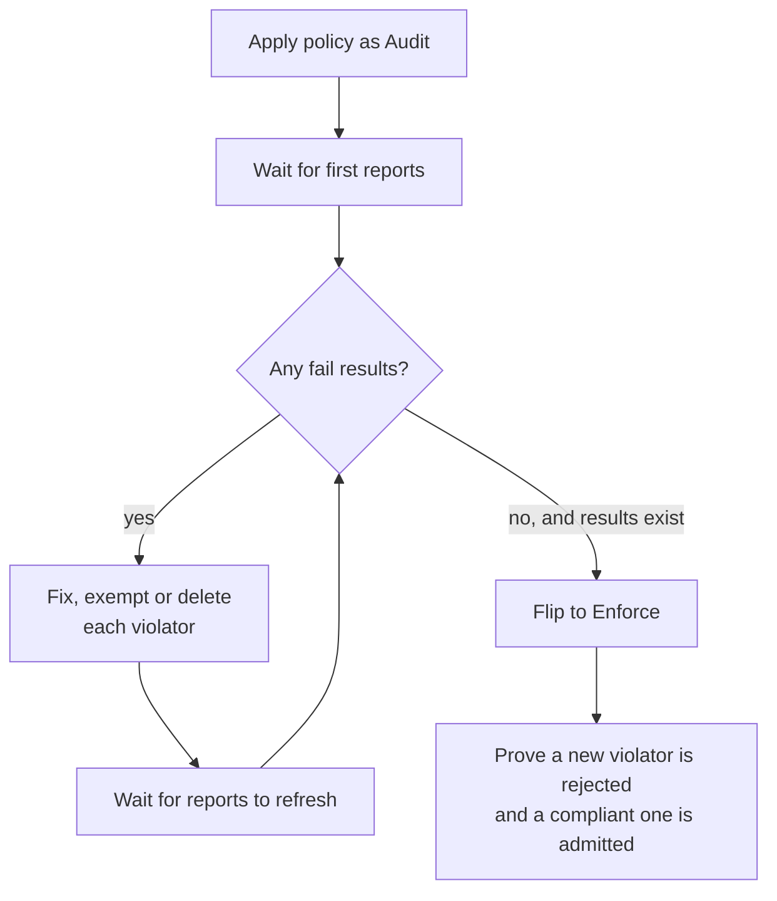

# Part 3 — Reports as a Rollout Gate

## The question a report answers

Turning `Audit` into `Enforce` is safe only if the existing cluster already complies, because from that moment every update of a violating resource is rejected, including updates that have nothing to do with the policy (a controller bumping a status annotation, for example). The reports tell you, with evidence, how many resources would be hit.



## The workflow, step by step

1. Apply the policy with `validationFailureAction: Audit`. Check it is `Ready`.
2. Wait until reports exist. An empty answer is not a green light: a policy with a typo in `match` selects nothing and produces no results, which looks identical to a clean cluster. A real gate asks for *evidence of passes* as well as an absence of fails. In the labs, "clean" means zero `fail` results and at least one `pass`.
3. List the failing resources with the Module 1 query. Decide for each one: fix the resource, delete it, or write a `PolicyException`.
4. Wait for the reports to catch up. Re-run the query until there is no `fail`, and the exceptions show as `skip`.
5. Patch the policy to `Enforce`:
   ```sh
   kubectl patch clusterpolicy require-owner-label --type merge \
     -p '{"spec":{"validationFailureAction":"Enforce"}}'
   ```
6. Prove it works: a server-side dry run of a violating resource is rejected, a compliant one is admitted.
   ```sh
   kubectl -n rollout-lab create --dry-run=server -f bad.yaml
   ```

For a gradual rollout, a policy can stay `Audit` in general and be `Enforce` for chosen namespaces through `validationFailureActionOverrides` (Section 010). The gate works per namespace in that case: check the reports of the namespaces you are about to enforce.

> [!NOTE]
> The gate protects existing resources. It cannot predict future ones, which is why step 6 matters: a new compliant resource must still pass, and a new violating resource must be stopped.

## Warnings at the client: emitWarning

An `Audit` failure is silent for the person who ran `kubectl apply`, because the request is admitted. A policy can opt in to telling them. Kyverno has a policy-level `emitWarning` setting; when it is `true`, `Audit` failures are returned to the API client as warnings, which `kubectl` prints in yellow. The default is `false`, and enabling it adds work to the admission request. Check the exact field in your version with `kubectl explain clusterpolicy.spec.emitWarning`. Warnings help developers see a violation at once, but they are not stored: the report is still the record.

## Metrics: the numbers over time

Reports describe the present. For trends ("is the number of failures going down?") Kyverno exposes Prometheus metrics, for example results counted per policy, rule and outcome (look for names starting `kyverno_policy_results`). They come from the Kyverno services' metrics endpoint in the `kyverno` namespace. Metric names and labels differ between releases, so open `/metrics` once and read what your version exposes before building a dashboard. Metrics are a pointer here, not part of the labs.

> [!TIP]
> **Try it — run the gate in the playground**
>
> The playground has a second policy, `require-owner-label-gate` (not yet applied, see `docs/overview.md`), starting in `Audit`. Apply it, wait for reports, list violators, fix or delete them, then flip it to `Enforce` and prove both sides of the behavior with `--dry-run=server`.

## Common mistakes

- Flipping to `Enforce` because "the report is empty", without checking the policy matched anything.
- Fixing the violators and flipping at once, without waiting for the reports to confirm.
- Forgetting existing resources are not rejected by `Enforce`: they stay as they are until updated, and then the update is rejected.
- Using a report as an audit log of rejected requests. It is not one.

## Reference

- `kubectl patch clusterpolicy <name> --type merge -p '{"spec":{"validationFailureAction":"Enforce"}}'`
- `kubectl create --dry-run=server -f <file>` — test admission without creating anything.
- `kubectl explain clusterpolicy.spec.emitWarning`
