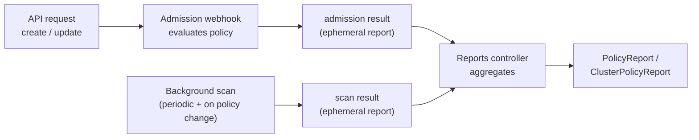

# Where Results Come From and How They Age

A report is a snapshot, not a log. Every result in it was written by one of two sources, and each result stays only as long as the resource and the policy that produced it exist. If you do not know the source, you cannot tell why a result is missing, why it is late, or why it is still there after you fixed the problem. This module explains the machinery behind the reports from the previous module, and then uses it for the decision reports exist to support: is this `Audit` policy safe to turn into `Enforce`?

The `PolicyReport` objects you read with `kubectl` are the product of this pipeline. The two inputs are an admission-time evaluation and a background scan. The reports controller merges both into the final report objects.

## How this module is organised

1. **[Part 1 — Two Sources: Admission and Background Scan](./course-01-admission-and-background-scan.md)** — when a result is written, what the scan interval is, what the internal ephemeral reports are, and what `Enforce` does and does not write.
2. **[Part 2 — Lifecycle: Deleted Resources, Deleted Policies and Skipped Results](./course-02-lifecycle-and-skipped-results.md)** — how results age, what happens when either side disappears, and why a `skip` shows up.
3. **[Part 3 — Reports as a Rollout Gate](./course-03-reports-as-a-rollout-gate.md)** — the workflow from `Audit` to `Enforce`, plus `emitWarning` and the metrics pointer.
4. **[Summary](./course-04-summary.md)** — what to remember.

## Learning objectives

After this module you can:

- Distinguish admission-time results from background-scan results and say when each is written.
- Name the reports controller's background scan interval flag and its default, and explain why a freshly applied policy may need a short wait before reports appear.
- Explain what ephemeral reports are, that they are an internal detail, and that you read the aggregated reports instead.
- Predict what happens to the results when a resource is deleted, fixed, or when its policy is deleted.
- Explain why an `Enforce` policy still produces `fail` results, and why a blocked request does not.
- Recognise a `skip` result and name the usual causes.
- Use reports as the go/no-go signal before flipping `Audit` to `Enforce`, and know where to look for metrics and warnings.

## Before you start

You should be able to read a `PolicyReport` with `kubectl` and `jq`. The playground gives you a kind cluster with Kyverno 1.13.2, an `Audit` policy and a handful of seeded ConfigMaps, so you can change a resource or the policy and watch the reports follow. `jq` is expected on your machine.

Launch your playground now, and keep it running next to you while you read the parts:

<!-- astrona:playground -->
