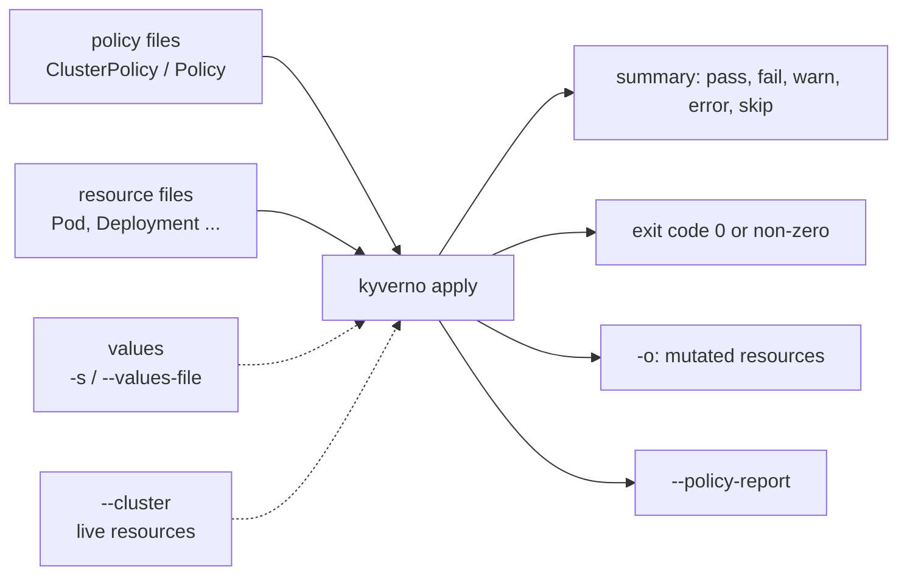

# Kyverno CLI: apply

A policy that you only test by applying it to a cluster is tested late. A mistake in a pattern can block real workloads, and a mistake in an `Audit` policy hides itself in a report that nobody reads. The Kyverno command-line tool (the `kyverno` command, or Kyverno CLI) runs the same policy engine on your laptop or in a CI job. `kyverno apply` takes policy files and resource files, evaluates them, prints the result and sets an exit code. No cluster is needed. This module teaches you to use it as the first gate for every policy.

## How this module is organised

1. **[Part 1 - Running kyverno apply on files](./course-01-running-kyverno-apply-on-files.md)** - policies and resources as arguments, the summary, exit codes, and `--audit-warn`.
2. **[Part 2 - Variables and mutate output](./course-02-variables-and-mutate-output.md)** - `-s`/`--set`, `--values-file`, and saving mutated resources with `-o`.
3. **[Part 3 - Cluster mode, reports and where the CLI differs](./course-03-cluster-mode-reports-and-differences.md)** - `--cluster`, `--policy-report`, and what a file-based run cannot know.
4. **[Summary](./course-04-summary.md)**

## Learning objectives

After this module you can:

- Install the Kyverno CLI v1.13.2 and run `kyverno apply` with one or more policies against one or more resource files.
- Read the pass, fail, warn, error and skip counts and predict the exit code for `Enforce` and `Audit` policies, with and without `--audit-warn`.
- Give a policy the variable values it needs with `-s`/`--set` or a `Values` file passed with `--values-file`.
- Save the result of a mutate policy to a file with `-o` and check it.
- Scan the resources of a live cluster with `--cluster`, and generate a policy report with `--policy-report`.
- Name at least four reasons why a CLI result can differ from the result in a live cluster.

## Before you start

You can write a Kyverno `ClusterPolicy` with a `validate` rule and a `mutate` rule, and you know what `validationFailureAction` does. The sandbox is a single-node `kind` cluster with Kyverno v1.13.2. The playground also installs the CLI v1.13.2 on your machine and creates the directory `$HOME/kyverno-lab/m1` with five Pod manifests. The namespace `lab` holds a Pod named `legacy` without a `team` label. No policy is applied to the cluster.

Launch your playground now and keep it running next to you while you read the parts:

<!-- astrona:playground -->
