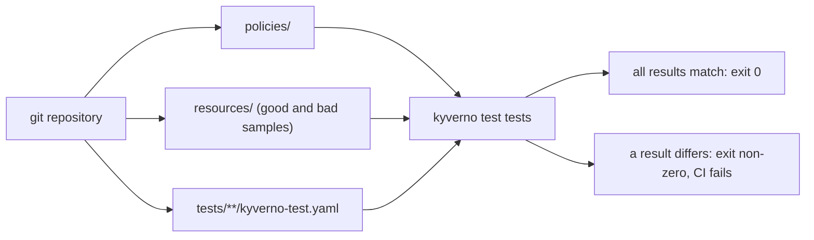

# Kyverno CLI: test

`kyverno apply` shows you a result once. `kyverno test` remembers it. You write the expected result of every policy rule for every sample resource in a file named `kyverno-test.yaml`, and the CLI compares the real result with it. The comparison runs on your laptop and in CI, so a change to a policy that breaks an expectation fails a build instead of a cluster. This module teaches the test file format, how to lay out a tests directory in git, how to run it in a pipeline, and how to read the detailed results.

## How this module is organised

1. **[Part 1 - The kyverno-test.yaml format](./course-01-the-kyverno-test-yaml-format.md)** - `policies`, `resources` and `results`, and what each result field means, including mutate tests.
2. **[Part 2 - Test layout in git and CI](./course-02-test-layout-in-git-and-ci.md)** - directory layout, running `kyverno test` in a pipeline, and what to test.
3. **[Part 3 - Detailed results and kyverno jp](./course-03-detailed-results-and-jp.md)** - `--detailed-results`, reading failures, and the `kyverno jp` command for JMESPath queries.
4. **[Summary](./course-04-summary.md)**

## Learning objectives

After this module you can:

- Write a `kyverno-test.yaml` with the `policies`, `resources` and `results` fields and use the result values `pass`, `fail` and `skip`.
- Write a test for a mutate rule with `patchedResources`.
- Organise tests in a git repository and run `kyverno test` in a CI job so that a wrong result fails the build.
- Use `--detailed-results` to see every rule and resource result, and find out why a test fails.
- Use `kyverno jp query` to try a JMESPath expression on a JSON or YAML file before you put it in a policy.

## Before you start

You can run `kyverno apply` and read its exit code. The playground installs the CLI v1.13.2 on your machine, a single-node `kind` cluster with Kyverno v1.13.2, and the directory `$HOME/kyverno-lab/m2` with two policies (`require-limits`, `add-managed-by-label`), three Pod manifests and empty `tests/limits`, `tests/labels` and `ci` directories.

Launch your playground now and keep it running next to you while you read the parts:

<!-- astrona:playground -->
